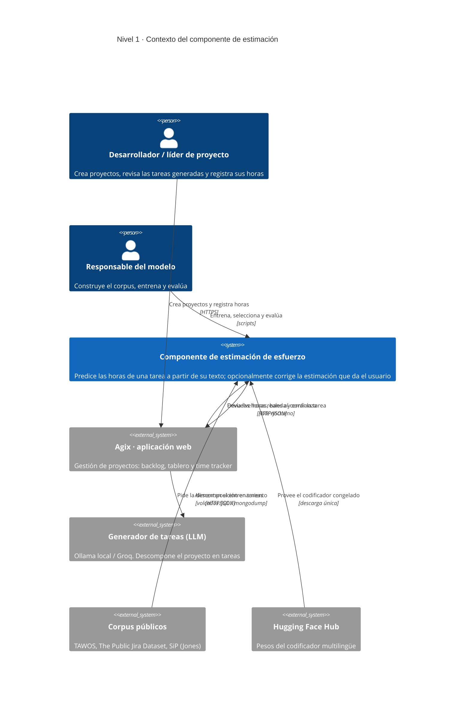
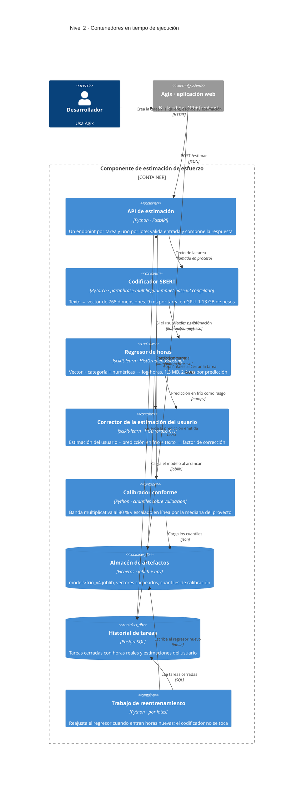
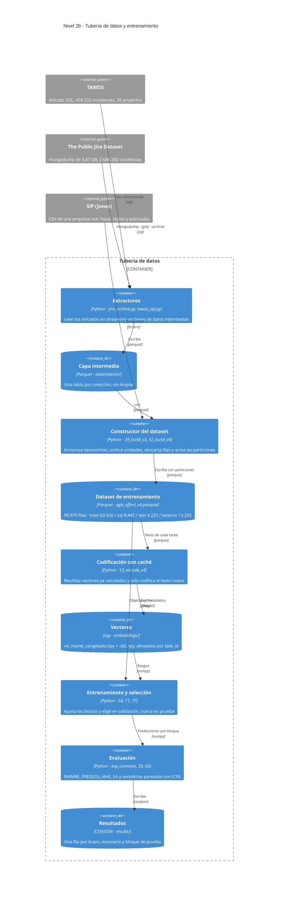
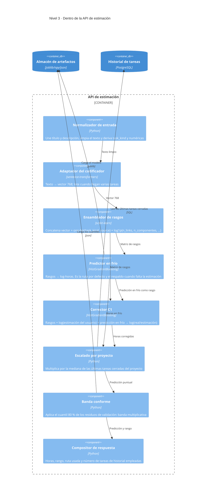
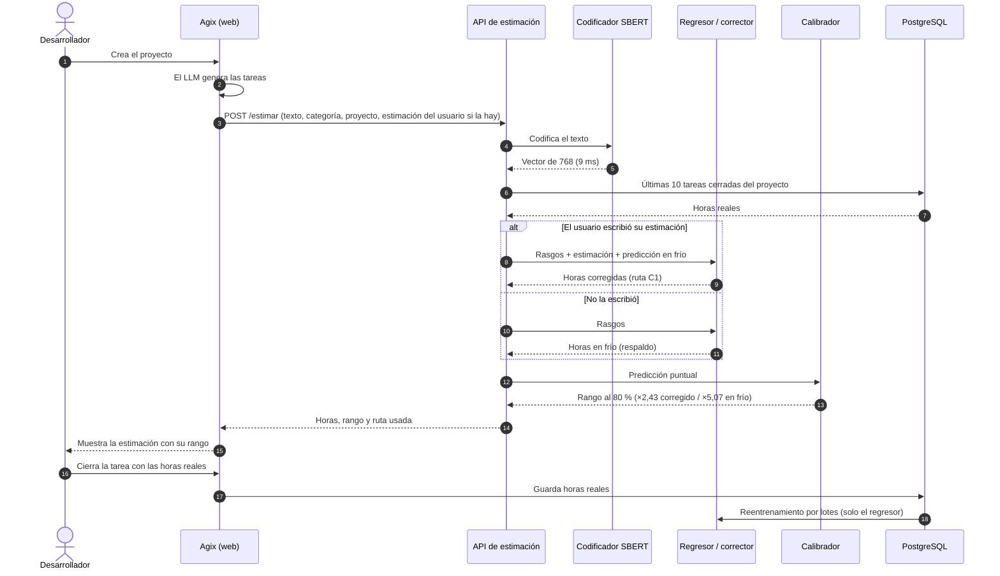

# Diagramas C4 · Componente de estimación de esfuerzo de Agix

Cuatro vistas: contexto, contenedores en ejecución, contenedores de la tubería de datos y
componentes internos, más una vista dinámica de una petición. Sintaxis Mermaid C4 (se
renderiza en GitHub, VS Code y la mayoría de visores Markdown).

---

## Nivel 1 · Contexto

---

## Nivel 2 · Contenedores en ejecución (lo que se despliega)

**Decisión de diseño que se ve aquí:** el codificador está congelado y solo el regresor (1,3 MB,
20 s de ajuste) se reentrena. Ajustar el codificador de extremo a extremo se probó y no mejoró
nada (MdMRE 0,686 frente a 0,685).

---

## Nivel 2b · Contenedores de la tubería de datos (fuera de línea)

**Garantías de la partición:** `test` es cronológica dentro de cada proyecto, `externo` son 150
proyectos enteros nunca vistos, y los duplicados se agrupan por hash de texto para que no crucen
particiones.

---

## Nivel 3 · Componentes de la API de estimación

---

## Vista dinámica · Una petición de estimación

---

## Cifras que respaldan los diagramas

| | |
|---|---|
| Codificador | 9 ms/tarea en GPU · 1,13 GB · determinista |
| Regresor | 2,4 ms/predicción · 1,3 MB · 20 s de reajuste |
| En frío (prueba fija) | MdMRE 0,685 · MAE 5,00 h · SA 0,42 |
| Con estimación corregida | MdMRE 0,494 · MAE 4,30 h · SA 0,50 |
| Banda al 80 % | ×5,07 en frío · ×2,43 corregida |
| Frente a LLMs locales | el LLM gana 1 de 24 comparaciones y tarda 28–218 veces más |
