# Diseño de la tubería completa de Agix

**De una descripción de producto a un backlog con horas estimadas.**

Son **dos tuberías encadenadas**, cada una con sus modelos, sus datos y su evaluación, y este
documento las reúne en uno solo:

| | qué hace | modelos | estado |
|---|---|---|---|
| **Tubería 1 · Generación** | descripción → historias de usuario con sus tareas | 2 × mT5-small podado (121 M) + SBERT propio + Marian | desplegado 28/09/2026 |
| **Tubería 2 · Estimación** | tareas → horas, y el total del proyecto | e5-large congelado + 2 ajustados + dos apilados | `estimador_agix_v6`, 29/09/2026 |

> **Alcance:** solo el diseño vigente de las dos tuberías. El camino de los experimentos
> descartados está en `ROL_FUNCION_LITERATURA.md`, `AUMENTO_DATOS_LITERATURA.md` (generación) y
> `INFORME_PROYECTO.md` (estimación). La demo web no se documenta aquí: es una envoltura, no
> parte de la tubería.

Los diagramas aparecen en **Mermaid** (se ven en GitHub y en VS Code) y, los de la generación,
también como **figura exportada** en SVG vectorial y PNG a 300 dpi para pegar en la memoria.

---

## Índice

**Parte 0 · La tubería completa**
- [0.1 De punta a punta](#01--de-punta-a-punta)
- [0.2 Figura A — Diagrama de flujo simple](#02--figura-a--diagrama-de-flujo-simple)
- [0.3 Figura B — La tubería completa en detalle](#03--figura-b--la-tubería-completa-en-detalle)
- [0.4 El contrato entre las dos tuberías](#04--el-contrato-entre-las-dos-tuberías)

**Parte A · Generación de historias y tareas** — [A.1](#a1-qué-hace-y-qué-decide-el-diseño) ·
[A.2 las cinco decisiones](#a2-las-cinco-decisiones-de-diseño) · [A.3 flujo](#a3-figura-1--flujo-de-extremo-a-extremo) ·
[A.4 etapas](#a4-detalle-de-cada-etapa) · [A.5 las dos mitades](#a5-figura-2--las-dos-mitades) ·
[A.6 plan de roles](#a6-figura-3--el-plan-de-roles-y-las-fichas-de-control) ·
[A.7 procedencia](#a7-figura-4--procedencia-de-datos-y-modelos) · [A.8 artefactos](#a8-artefactos-que-se-cargan-en-ejecución) ·
[A.9 configuración](#a9-configuración-desplegada) · [A.10 reproducir](#a10-cómo-reproducir-desde-cero) ·
[A.11 evaluación](#a11-protocolo-de-evaluación) · [A.12 resultados](#a12-resultados) ·
[A.13 lo que queda mal](#a13-lo-que-queda-mal-y-las-vías-cerradas) · [A.14 archivos](#a14-mapa-de-archivos)

**Parte B · Estimación de esfuerzo** — [B.1](#b1--qué-hace-y-en-una-tabla) ·
[B.2 dos cabezas](#b2--la-decisión-que-estructura-todo-dos-cabezas) · [B.3 diagramas](#b3--diagramas-de-flujo) ·
[B.4 datos](#b4--los-datos) · [B.5 arquitectura](#b5--arquitectura-interna) ·
[B.6 mecanismos de proyecto](#b6--los-tres-mecanismos-que-usan-información-del-proyecto) ·
[B.7 contrato](#b7--contrato-de-la-interfaz) · [B.8 artefactos y rendimiento](#b8--artefactos-y-rendimiento-medido) ·
[B.9 calidad](#b9--calidad-medida) · [B.10 límite conocido](#b10--límite-conocido-la-compresión-de-la-escala) ·
[B.11 operación](#b11--operación) · [B.12 decisiones](#b12--resumen-de-decisiones-de-diseño)

---

## 0.1 · De punta a punta

**Entrada**: una descripción de producto en español o en inglés, de una o dos frases.
**Salida**: **12 historias de usuario** en formato «Como X, quiero Y, para Z», cada una con sus
**tareas en español**, cada tarea con sus **horas**, y el **total del proyecto con un intervalo**.

| | coste medido |
|---|---|
| Tubería 1 · generar el backlog | ~26 s en RTX 5060 · ~33 s en CPU |
| Tubería 2 · estimar las horas | **5 s en CPU** para unas 35 tareas |
| carga de los modelos, una sola vez | ~20 s + ~2 s |

Ninguna de las dos llama a un servicio externo: todo corre en la máquina.

---

## 0.2 · Figura A — Diagrama de flujo simple

Lo mínimo que hay que entender: **qué entra y qué sale de cada tubería**, y que lo que la segunda
consume es el **inglés** de la primera, no su traducción.

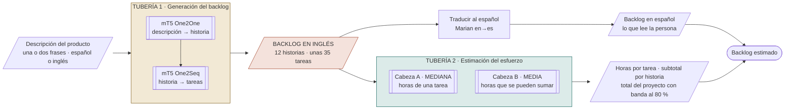

**Las formas dicen qué es cada cosa**, y se mantienen en las dos figuras:

| forma | significa | ejemplo |
|---|---|---|
| `[/paralelogramo/]` | **datos** que entran o salen | la descripción, el backlog, las horas |
| `[[subrutina]]` | un **modelo** entrenado | los dos mT5, las dos cabezas |
| `[rectángulo]` | un **paso de proceso** sin modelo | traducir, deduplicar, sumar |
| `{rombo}` | una **decisión** | ¿está en español?, ¿hay tareas cerradas? |
| `[(cilindro)]` | un **almacén** que se consulta | los corpus de vecinos |
| `([estadio])` | principio y **final** | el backlog estimado |

**El punto que más importa de esta figura**: el nodo rojo del centro es a la vez **la salida de la
tubería 1 y la entrada de la tubería 2**, y está **en inglés**. La traducción al español es una
rama lateral, solo para mostrar. Pasarle el español al estimador no fallaría; simplemente
acertaría menos, porque su contrato pide inglés.

---

## 0.3 · Figura B — La tubería completa en detalle

Las mismas dos tuberías con todas sus etapas reales.

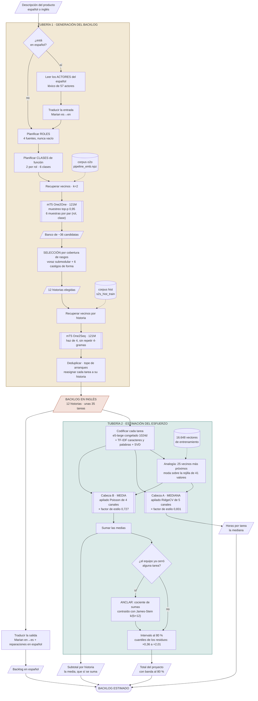

Tres cosas que esta figura hace explícitas y que son todo el diseño:

1. **La tubería 1 genera; el pipeline decide.** El modelo de arriba produce ~36 candidatas y la
   selección por cobertura elige 12. La calidad no sale del modelo, sale de la elección.
2. **La tubería 2 tiene dos cabezas y no una.** La de la mediana contesta «cuánto tarda esta
   tarea» y la de la media contesta «cuánto suma esto». No son el mismo número y no se pueden
   intercambiar.
3. **Las dos se juntan por el inglés**, y cada una aplica su propio factor de estilo porque el
   texto del generador no se parece a un título de Jira.

---

## 0.4 · El contrato entre las dos tuberías

Lo que una entrega y la otra espera. Está implementado en `src/34_estimacion.py` (en el
repositorio de la generación).

| | |
|---|---|
| **qué se pasa** | `h["tareas"]`, la lista de tareas **en inglés**, antes de traducir |
| **qué NO se pasa** | `h["tareas_es"]`: el estimador se entrenó con títulos de Jira en inglés |
| **qué devuelve** | horas por tarea, subtotal por historia, total con intervalo |
| **orden** | el factor de estilo se aplica **antes** del anclaje con tareas cerradas |

**El factor de estilo del total no es el de la mediana.** La cabeza A multiplica por 0,8313; la
cabeza B no aplicaba nada, y el factor de la cabeza A no vale porque son dos modelos con pérdidas
distintas. Medido (E74) sobre las 800 tareas reales reescritas al estilo del generador, todas
fuera del entrenamiento, con cociente de sumas:

| texto de entrada | suma predicha / suma real |
|---|---|
| título original de Jira | **1,0018** — calibrado |
| el mismo contenido en estilo del generador | **1,3775** |
| **factor que lo corrige** | **0,7273** |

Sin esa corrección **el total del proyecto sale un 37 % alto**. Con ella, la media por tarea de un
backlog generado queda en 6,3 h, que es la media del corpus (6,11 h).

**Por qué se aplica antes del anclaje**: el anclaje es un cociente de sumas, así que un factor
constante se cancelaría solo si no hubiera contracción. Con James-Stein (`k/(k+12)`) la
cancelación es parcial, y la predicción corregida es el mejor punto hacia el que contraer.

---

---

# PARTE A · Generación de historias y tareas

> La primera tubería: de la descripción del producto al backlog. Estado desplegado a
> 28/09/2026. Los experimentos descartados están en `ROL_FUNCION_LITERATURA.md` y
> `AUMENTO_DATOS_LITERATURA.md`.

---

## A.1 Qué hace y qué decide el diseño

**Entrada**: una descripción de producto en español o en inglés, de una o dos frases.
**Salida**: **12 historias de usuario** en formato «Como X, quiero Y, para Z», cada una con sus
**tareas**, en español.

**Coste**: ~26 s por descripción en una RTX 5060, de los cuales ~20 s son cargar los modelos una sola
vez. Dos mT5-small podados de 121 M parámetros cada uno; entran de sobra en 8 GB de VRAM.

El problema que el diseño tiene que resolver no es generar texto plausible —un modelo pequeño lo hace—
sino tres cosas que un modelo pequeño **no** hace solo:

1. que el backlog tenga **varios actores** y que sean los del producto descrito;
2. que no sean doce historias de **pedir ver cosas**;
3. que las tareas pertenezcan a **su** historia y no se repitan.

Las tres se resuelven **fuera del modelo**: condicionando la generación con fichas de control y
eligiendo después entre muchas candidatas. El modelo genera; el pipeline decide.

---

## A.2 Las cinco decisiones de diseño

Cada una con el número que la sostiene. Son las que hay que poder defender.

### A.2.1 Dos modelos encadenados, no uno

Un solo modelo que fuera de la descripción al backlog completo tendría que aprender a la vez a
inventar historias y a descomponerlas. Se separa en **descripción → una historia** (One2One) y
**historia → sus tareas** (One2Seq), cada uno con sus datos y su decodificación. Permite además
muestrear arriba (hacen falta muchas candidatas para elegir) y usar haz abajo (ahí se quiere la mejor
descomposición, no variedad).

### A.2.2 Fichas de control al estilo CTRL

A la entrada de la mitad de arriba se le anteponen dos fichas: `| role: X |` y `| funcion: Y |`.

- **Ficha de rol.** Sin ella el backlog se concentra en un actor. Medido: con plantel de actores la
  obediencia al rol es **100 %**; sin plantel, **7 %**.
- **Ficha de función.** El modelo se concentraba en pedir *ver* cosas: el 42 % de las historias eran de
  clase `view`, contra el 22 % de las humanas. Con la ficha, la obediencia es del **99 %** y la
  entropía de clases pasa de 2,22 a **2,39** sobre un máximo de 2,58, con las humanas en 2,45.

### A.2.3 Los actores se leen del ESPAÑOL, antes de traducir

El plan de roles se construía sobre la descripción ya traducida, y la traducción destruye los actores:
«apoderados» → «**agents**», «avisa al equipo» → «alerts the **computer**». Y es **inestable**: la
misma palabra sale «proxy» en una frase corta y «agents» en la descripción completa, así que un
diccionario sobre el inglés no puede arreglarlo.

Medición que cierra el diagnóstico: una sonda directa de obediencia, 8 muestras por petición y 32
peticiones, da **8/8 en 31 de 32**, incluidos `guardian`, `vendor` y `team member`. **El modelo obedece;
el rol llegaba mal.** Por eso se lee del español, que es la fuente.

### A.2.4 Selección por cobertura de rasgos, no por relevancia

De las ~36 candidatas generadas se eligen 12 maximizando la **cobertura de los rasgos que la
descripción enumera** (localización de instalaciones, voraz submodular), no la relevancia individual.
Medido sobre 30 descripciones reservadas: los rasgos cubiertos pasan del 81,1 % al **87,8 %**, y los
backlogs que los cubren todos del 53,3 % al **66,7 %**. Cuesta 2,6 puntos de atribución, y se acepta:
un rasgo sin cubrir es trabajo que no existe en el backlog.

Sobre esa selección van **seis castigos de forma** (circularidad, autorreferencia, eco, rol-función,
largo, beneficio vacío) y tres términos de cobertura (rol, clase de función, beneficio literal).

### A.2.5 El aumento de datos imita las condiciones de inferencia

El modelo se entrenaba con descripciones en inglés **escritas a mano**, pero en producción la entrada
es español que pasa por Marian. Ese inglés no habla igual: el viaje de ida y vuelta cambia el **38 %
de las palabras**. Se añadieron al conjunto los mismos ejemplos con la descripción retrotraducida por
los **mismos** modelos que el producto usa. Resultado pareado con tres semillas: **+0,0118 de sF1**,
las tres a favor, con desviación 0,0017.

---

## A.3 Figura 1 — Flujo de extremo a extremo

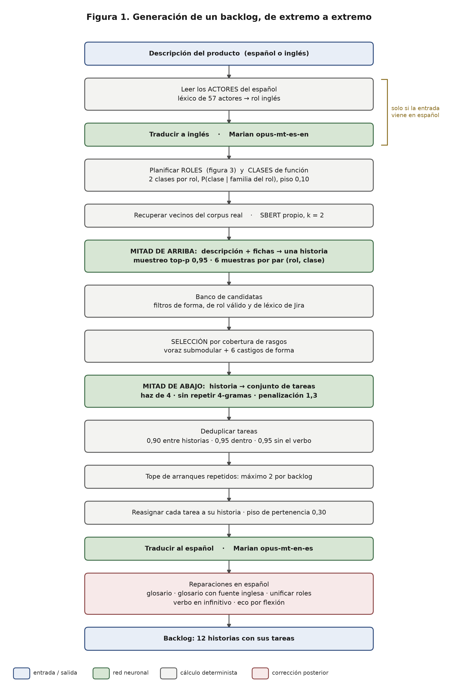

*Archivos: `reports/figuras_generacion/fig1_pipeline.svg` · `reports/figuras_generacion/fig1_pipeline.png`*

```mermaid
flowchart TD
    A["Descripción del producto<br/>(español o inglés)"] --> B{"¿está en español?"}
    B -->|sí| B1["Leer los ACTORES del español<br/>actores_es_nombrados"]
    B1 --> B2["Traducir a inglés<br/>Marian opus-mt-es-en"]
    B -->|no| C
    B2 --> C["Planificar ROLES<br/>PlanificadorRoles"]
    C --> D["Planificar CLASES de función<br/>plan_funciones"]
    D --> E["Recuperar vecinos del corpus<br/>k=2, tabla o2o"]
    E --> F["MITAD DE ARRIBA<br/>descripción + fichas → 1 historia<br/>muestreo, 6 por par (rol, clase)"]
    F --> G["Banco de candidatas<br/>filtros de forma y de léxico"]
    G --> H["SELECCIÓN por cobertura de rasgos<br/>seleccion_por_rasgos, voraz"]
    H --> I["Recuperar vecinos por historia<br/>tabla hist"]
    I --> J["MITAD DE ABAJO<br/>historia → conjunto de tareas<br/>haz de 4"]
    J --> K["Deduplicar tareas<br/>global 0,90 · intrahistoria 0,95<br/>y 0,95 sin el verbo"]
    K --> L["Tope de arranques repetidos<br/>máximo 2 por backlog"]
    L --> M["Reasignar la tarea a su historia<br/>y piso de pertenencia 0,30"]
    M --> N["Traducir al español<br/>Marian opus-mt-en-es"]
    N --> O["Reparaciones en español<br/>glosario · glosario con fuente<br/>unificar roles · verbo en infinitivo<br/>eco por flexión"]
    O --> P["Backlog final<br/>12 historias con tareas"]
```

Las etapas que el propio pipeline cronometra, en orden: `traducir_entrada`, `recuperar_arriba`,
`generar_historias`, `deduplicar_historias`, `recuperar_abajo`, `generar_tareas`, `deduplicar_tareas`,
`reasignar_tareas`, `traducir`, `total`.

---

## A.4 Detalle de cada etapa

| # | etapa | qué hace | dónde está |
|---|---|---|---|
| 1 | Actores del español | 57 actores del español al rol inglés que el generador espera. Solo si la entrada viene en español | `actores_es_nombrados` |
| 2 | Traducir la entrada | Marian `opus-mt-es-en` | `Pipeline.__call__` |
| 3 | Plan de roles | cuatro fuentes en orden de fiabilidad (figura 3) | `PlanificadorRoles` |
| 4 | Plan de clases | 2 clases por rol según P(clase \| familia del rol), con piso 0,10 | `plan_funciones` |
| 5 | Vecinos de arriba | 2 ejemplos del corpus real por similitud del SBERT propio, que van en el prompt | `_vecinos` |
| 6 | Generación de arriba | una tanda de muestreo **por par (rol, clase)**, mínimo 6 muestras cada una | `_generar` |
| 7 | Filtros del banco | formato de historia, rol válido (persona, no sustantivo cualquiera), léxico de Jira | `rol_valido`, `degenerada_texto` |
| 8 | Selección | cobertura de rasgos + 3 términos de reparto + 6 castigos de forma | `seleccion_por_rasgos` |
| 9 | Vecinos de abajo | ejemplos para cada historia elegida | `_vecinos` |
| 10 | Generación de abajo | haz de 4, sin repetir 4-gramas, penalización 1,3 | `_generar` |
| 11 | Deduplicar tareas | 0,90 entre historias · 0,95 dentro · 0,95 **sin el verbo inicial** | `__call__` |
| 12 | Tope de arranques | máximo 2 tareas por backlog con el mismo arranque de dos palabras | `arranque` |
| 13 | Reasignar | cada tarea va a la historia a la que de verdad pertenece; piso 0,30 | `__call__` |
| 14 | Traducir la salida | Marian `opus-mt-en-es` | `__call__` |
| 15 | Reparaciones | glosario, glosario con fuente inglesa, unificar nombres de rol, verbo en infinitivo, eco por flexión | `glosario`, `glosario_fuente`, `unificar_roles_es`, `normalizar_verbo_es`, `eco_por_raiz` |

**Por qué el tope de arranques está en la salida y no en los datos**: los datos de entrenamiento ya
están planos (3,0 % de concentración en los cinco arranques más frecuentes, contra 2,6 % humano) y el
modelo los amplifica ×14,6 hasta el 43,8 %. Es una propiedad del decodificador, así que se corrige en
inferencia.

---

## A.5 Figura 2 — Las dos mitades

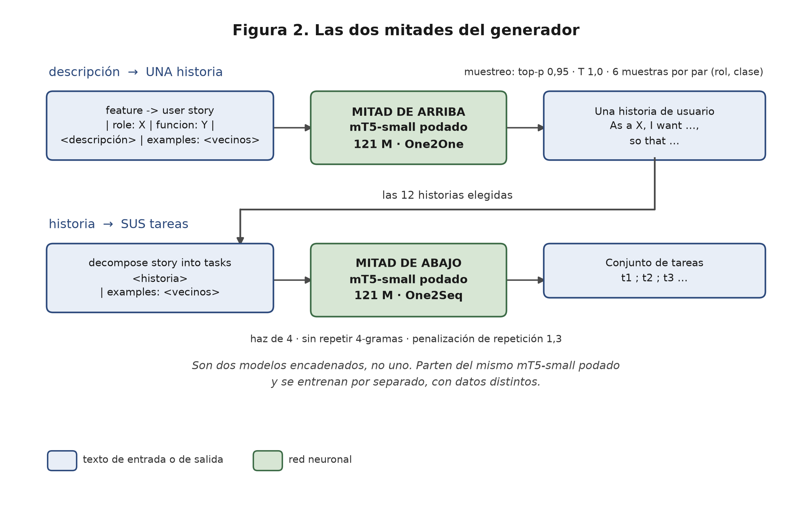

*Archivos: `reports/figuras_generacion/fig2_dos_mitades.svg` · `reports/figuras_generacion/fig2_dos_mitades.png`*

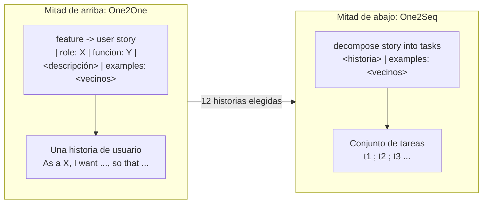

Formato exacto de entrada de cada mitad:

```
arriba:  feature -> user story | role: courier | funcion: track | <descripción> | examples: <vecinos>
abajo:   decompose story into tasks: <historia> | examples: <vecinos>
```

| | decodificación | por qué |
|---|---|---|
| arriba | muestreo, top-p 0,95, T 1,0, ~6 muestras por par (rol, clase) | hacen falta muchas candidatas para que la selección pueda elegir |
| abajo | haz de 4, `no_repeat_ngram_size=4`, `repetition_penalty=1,3` | aquí no se quiere variedad, se quiere la mejor descomposición |

---

## A.6 Figura 3 — El plan de roles y las fichas de control


*Archivos: `reports/figuras_generacion/fig3_plan_roles.svg` · `reports/figuras_generacion/fig3_plan_roles.png`*

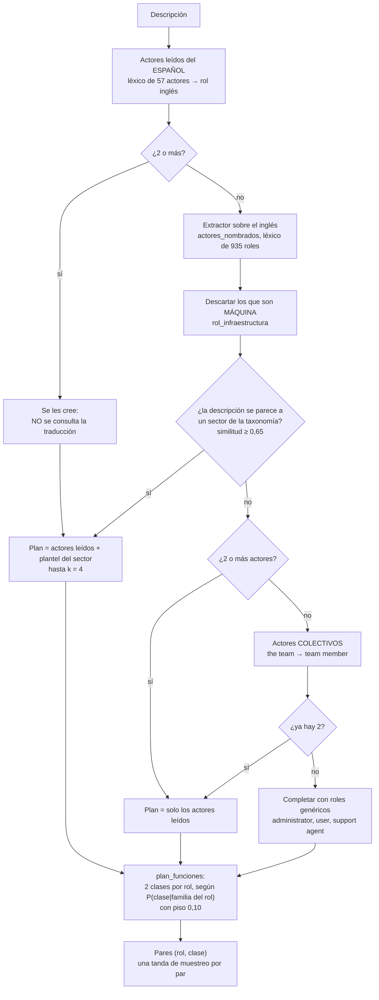

**Las seis clases de función** salen de agrupar con el SBERT propio los verbos del medio de 9.077
historias (`src/84_clases_funcion.py`), no de una lista escrita a mano: **receive, view, set, track,
monitor, manage**.

**El plan nunca queda vacío**, y esa es la regla que más basura evita. Cuando lo estaba, el modelo
inventaba el actor: en el dominio de integración continua salían **6 roles fabricados en 12
historias** («hydrator user», «spending collector», «volunteer»).

Dos reglas del plan, las dos falsificadas antes de entrar:

- **Descartar el actor que es máquina** («runs build pipelines **on agents**»): probada contra las 622
  descripciones de la taxonomía, descarta **0 de 1.507** actores, y 1 de 14 en los siete dominios del
  producto, que es justo el que se buscaba.
- **Si el español nombra 2 actores o más, no se consulta la traducción**, porque su entrada es una
  versión con pérdidas de la misma frase.

---

## A.7 Figura 4 — Procedencia de datos y modelos


*Archivos: `reports/figuras_generacion/fig4_procedencia.svg` · `reports/figuras_generacion/fig4_procedencia.png`*

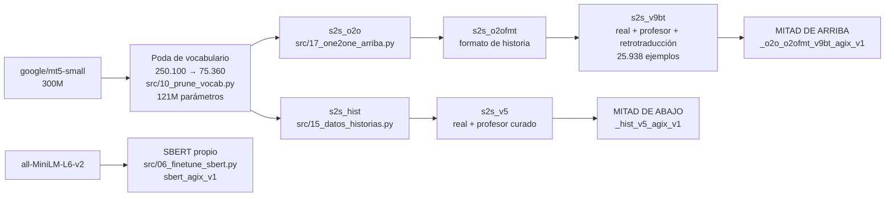

Hiperparámetros de las dos etapas finales, que son las que hay que repetir:

| mitad | base | bs × acum | max_out | lr | épocas | val por época |
|---|---|---|---|---|---|---|
| arriba (`v9bt`) | `_o2o_agix_v1_o2ofmt_agix_v1` | 32 × 1 | 48 | 5e-4 | 4 | 1,7947 · 1,8017 · **1,7897** · 1,8208 |
| abajo (`v5`) | `_hist_agix_v1` | 16 × 1 | 192 | 5e-4 | 4 | **3,3210** · 3,3393 · 3,3565 |

Se guarda la **mejor época por pérdida de validación**, no la última.

**Nota de licencia**: el profesor sintético es `qwen2.5:7b`, Apache-2.0, elegido a propósito. Llama
queda excluido porque su licencia obligaría a poner «Llama» en el nombre del modelo resultante.

**La poda de vocabulario no cuesta calidad**: medido pareado, −0,0019 de sF1 con IC95 [−0,0050,
+0,0011], es decir empate; y sin podar, el lote 16 no cabe en 8 GB.

---

## A.8 Artefactos que se cargan en ejecución

| artefacto | lo produce | para qué |
|---|---|---|
| `models/..._v9bt_agix_v1` | `09_train_mt5.py` | mitad de arriba |
| `models/..._hist_agix_v1_v5_agix_v1` | `09_train_mt5.py` | mitad de abajo |
| `models/sbert_agix_v1` | `06_finetune_sbert.py` | recuperación, selección, deduplicado |
| `models/reordenador_beneficio.joblib` | `74_reordenador.py` | bonificación por coherencia del beneficio (AUC 0,728) |
| `data/processed/pipeline_emb.npz` | `08_preprocess.py` | embeddings del corpus para recuperar vecinos |
| `data/processed/s2s_o2o_train.parquet` | `17_one2one_arriba.py` | tabla de vecinos de arriba |
| `data/processed/s2s_hist_train.parquet` | `15_datos_historias.py` | tabla de vecinos de abajo |
| `data/processed/roles_lexico.json` | `55_lexico_roles.py` | 935 roles, 262 núcleos de persona, 114 vetados |
| `data/processed/clases_funcion.json` | `84_clases_funcion.py` | las 6 clases y P(clase \| familia de rol) |
| `data/processed/matriz_rol_verbo.json` | `83_matriz_rol_verbo.py` | asociación rol×verbo |
| `data/processed/lexico_jira_estricto.json` | `81_lexico_jira_estricto.py` | 167 palabras de Jira a vetar en las tareas |
| `data/synth/descripciones_v3.json` | `53_dominios_v3.py` | 622 descripciones y el plantel de 40 sectores |
| `Helsinki-NLP/opus-mt-{es-en,en-es}` | caché en `models/hf_cache` | traducción de entrada y de salida |

Comprobar que están todos: `python src/91_comprobar_entorno.py`.

---

## A.9 Configuración desplegada

Todo se puede sobreescribir por variable de entorno; estos son los valores por omisión.

| parámetro | valor | qué controla |
|---|---|---|
| `K_HISTORIAS` | 12 | historias del backlog |
| `N_MUESTRAS` | 30 | candidatas pedidas (mínimo 6 por par rol×clase) |
| `K_VECINOS` | 2 | vecinos recuperados por consulta |
| `UMBRAL_SECTOR` | 0,65 | a partir de aquí se usa el plantel del sector |
| `MODO_ROLES` | `descripcion` | manda lo que la descripción nombra |
| `MIN_ACTORES_CON_PLANTEL` | 1 | con plantel basta un actor leído |
| `MIN_ACTORES_SIN_PLANTEL` | 2 | sin plantel hacen falta dos |
| `MODO_FUNCION` | `auto` | ficha de función; se activa por el nombre del modelo |
| `CLASES_POR_ROL` | 2 | clases de función por actor |
| `PISO_CLASE` | 0,10 | probabilidad mínima para asignar una clase a un rol |
| `NU_CIRCULAR` · `NU_AUTO` · `NU_ECO` · `NU_ROLFUN` · `NU_VACIO` | 0,50 · 0,40 · 0,40 · 0,45 · 0,45 | castigos por la forma de la historia |
| `NU_CAP` | **0,0** | castigo por capacidad repetida: **apagado, descartado con medición** |
| `UMBRAL_TAREA_DUP` | 0,90 | tareas duplicadas entre historias distintas |
| `UMBRAL_TAREA_DUP_INTRA` | 0,95 | dentro de una misma historia |
| `UMBRAL_TAREA_SINV` | 0,95 | ídem, comparando **sin el verbo inicial** |
| `TOPE_ARRANQUE_SALIDA` | 2 | veces que se repite un arranque de dos palabras |
| `PISO_TAREA` | 0,30 | pertenencia mínima de la tarea a su historia |
| `BEAMS_ABAJO` | 4 | anchura del haz de la mitad de abajo |
| `ECO_RAIZ` | 1 | eco por flexión, también en español |

> **Cuidado al desplegar un modelo nuevo.** Las fichas de rol y de función se activan por el **nombre**
> del modelo, con la lista `CON_FICHA = ("v3r", "v8ff", "v9bt", "v9df")` en `src/19_pipeline.py`. Un
> modelo cuyo nombre no esté ahí corre **sin fichas** —es decir, sin la mitad del diseño— **y sin
> avisar**. `src/92_ver_salida.py` imprime al arrancar si están activas, precisamente por esto.

---

## A.10 Cómo reproducir desde cero

Intérprete: `C:\Users\User\Documents\Programacao\Agix-Dataset\.venv\Scripts\python.exe` o
`F:\Agix\venv\Scripts\python.exe` (los dos tienen torch 2.11 + cu128). **El `python` del PATH no
sirve.** Las rutas del proyecto están al principio de cada script.

```bash
# --- 1. corpus real (Jira / TAWOS) y particion por proyecto
python src/01_extract_jira_full.py
python src/02_extract_tawos_changelog.py
python src/03_build_hierarchy.py
python src/04_split_projects.py

# --- 2. SBERT propio, que usa todo lo demas
python src/05_sbert_pairs.py
python src/06_finetune_sbert.py

# --- 3. datos de las dos mitades y poda del vocabulario
python src/08_preprocess.py
python src/10_prune_vocab.py
python src/15_datos_historias.py      # abajo: historia -> tareas
python src/17_one2one_arriba.py       # arriba: descripcion -> una historia

# --- 4. datos sinteticos del profesor (requiere ollama con qwen2.5:7b)
python src/53_dominios_v3.py          # 622 descripciones sobre 40 sectores
python src/54_generar_v3.py qwen2.5:7b
AGIX_SYNTH=backlogs_v3_qwen2.5_7b.jsonl AGIX_PREF=v8f python src/43_datos_mixtos.py

# --- 5. el aumento por retrotraduccion (lo que distingue a v9bt)
python src/88_retrotraducir_datos.py 0.5

# --- 6. entrenamiento de las dos mitades
DATOS=v9bt python src/09_train_mt5.py models/mt5-small-pruned_o2o_agix_v1_o2ofmt_agix_v1 32 48 0.0005 4
DATOS=v5   python src/09_train_mt5.py models/mt5-small-pruned_hist_agix_v1 16 192 0.0005 4

# --- 7. recursos que el pipeline carga en ejecucion
python src/55_lexico_roles.py
python src/81_lexico_jira_estricto.py
python src/83_matriz_rol_verbo.py
python src/84_clases_funcion.py
python src/74_reordenador.py

# --- 8. comprobacion
python src/91_comprobar_entorno.py
python src/19_pipeline.py --demo
AGIX_SEED=20260926 python src/49_eval_real.py nuevo
```

---

## A.11 Protocolo de evaluación

Tres medidas con propósitos distintos, y conviene no confundirlas.

| medida | contra qué | script | para qué sirve |
|---|---|---|---|
| **sF1 suave de conjunto** | 328 historias escritas por **personas** en 6 proyectos reales | `49_eval_real.py` | **la única que no se explica por imitar al profesor.** Es la que decide |
| atribución tarea→historia | consigo misma | `92_ver_salida.py` | coherencia interna. **Sube al empobrecer el backlog, así que sola engaña** |
| coherencia y cobertura | rasgos enumerados en la descripción | `52_coherencia.py`, `68_cobertura` | si el backlog cubre lo que se pidió |

Cuatro reglas de medición que este proyecto aprendió a la fuerza:

1. **Tres semillas, pareadas.** Una sola corrida tiene un ruido de ~0,012 de sF1, del tamaño de los
   efectos que se buscan. Cada semilla se corre en los **dos** brazos y se compara la diferencia.
2. **La línea base se regenera en la misma sesión.** Con la misma semilla y el mismo código, una
   corrida de dos horas antes **no** se reproduce; dos seguidas sí, byte a byte. Para el «antes» se
   copia el respaldo de `respaldo/19_pipeline_*.py` a `src/` y se carga por ruta.
3. **Leer la salida en texto antes de mirar los números.** `python src/92_ver_salida.py <etiqueta>`
   imprime los 7 dominios de prueba. Varias mejoras aparentes en las métricas resultaron ser el
   backlog empobreciéndose.
4. **El sF1 puntúa solo las historias**, no las tareas (`H = [h["historia"] for h in r["historias"]]`).
   Un cambio que solo toque tareas no puede moverlo, y no hace falta medirlo con semillas.

---

## A.12 Resultados

### Contra historias escritas por personas

| versión | sF1 (media de 3 semillas) |
|---|---|
| modelo anterior (`v8ff`) | 0,6245 |
| **desplegado (`v9bt`)** | **0,6363** |

Diferencia **+0,0118**, medida pareada: las tres semillas a favor, desviación 0,0017.

### Sobre los 7 dominios de prueba (84 historias, ~250 tareas)

| | antes | ahora |
|---|---|---|
| Roles **fabricados** | 12 de 84 | **0** |
| Roles inexistentes por error de traducción | 4 de 84 | **0** |
| El actor que la descripción nombra llega al backlog | 5 de 7 dominios | **7 de 7** |
| Historias casi duplicadas (personas 4,8 %) | 10,7 % | **7,1 %** |
| Beneficio vacío (personas 0 de 235) | 3 de 84 | **0** |
| Tareas gemelas dentro de una historia | 3 pares | **0** |
| Eco por flexión | 3,1 % | **0,8 %** |
| Historias sin ninguna tarea | 4,8 % | **~1 %** |
| Formato «Como… quiero… para…» | — | **100 %** |
| Atribución tarea→historia | 83 % | **86 %** |

---

## A.13 Lo que queda mal y las vías cerradas

Escrito para que nadie lo descubra creyendo que es nuevo.

| defecto | tasa medida | estado |
|---|---|---|
| **Fuga de vocabulario de otro sector** («mi **prenda**» en bodas, «mi **scooter**» en técnico, «perfil de la **enfermera**» en un colegio) | ~1 por backlog | **CERRADO como negativo medido.** El veto por sector marca 18 historias y solo 1 es fuga real; y los dominios con fugas son los que no empatan con ningún sector, así que ahí el conjunto de palabras «propias» también está mal. *Solo es seguro donde no hace falta* |
| **Historias casi duplicadas** del mismo actor | 7,1 % (personas 4,8 %) | **CERRADO.** El castigo funciona (→ 0 %) pero cuesta 0,007 de sF1 con las tres semillas en contra, y 0 % se pasa del nivel humano |
| **Plantilla CRUD en las tareas** | — | **CERRADO.** Bajar la plantilla en los datos 4,6 puntos movió la salida 0,3: es del decodificador, no de los datos |
| Beneficio con un objeto ajeno al dominio | ~4 de 84 | abierto; misma familia que la fuga de sector |
| Eco por flexión residual | 0,8 % de las tareas | abierto |
| Términos técnicos que el traductor de salida rompe | corregidos *branch*, *runs*, *pipeline* | abierto para el resto; se amplía en `_GLOSARIO_FUENTE` |
| Diversidad de superficie de las descripciones sintéticas | 81 arranques distintos para 622 | abierto; la vía sería generar con atributos ortogonales al estilo AttrPrompt, lo que exige volver a pasar el profesor |

---

## A.14 Mapa de archivos

### Producción

| archivo | qué es |
|---|---|
| `src/19_pipeline.py` | **el módulo entero.** Todo lo de producción está aquí |
| `src/91_comprobar_entorno.py` | verifica los 13 artefactos y la GPU, sin cargar modelos |
| `src/92_ver_salida.py` | genera y enseña los 7 dominios, con la tabla de cifras y `--comparar` |
| `src/49_eval_real.py` | sF1 contra las 328 historias humanas |
| `src/33_servidor.py` | demostración web en el puerto 8123 |
| `src/90_figuras.py` | regenera las cuatro figuras de este documento |

### Datos y entrenamiento

`09_train_mt5.py`, `43_datos_mixtos.py`, `88_retrotraducir_datos.py`, `89_dedup_historias_profesor.py`,
más los de la sección 10.

### Documentación

| documento | contenido |
|---|---|
| **`DISENO_PIPELINE.md`** | este documento: el diseño completo de las DOS tuberías |
| `ESTADO_Y_PUESTA_EN_MARCHA.md` | qué se consiguió y cómo poner en marcha y probar el módulo |
| `ROL_FUNCION_LITERATURA.md` | los experimentos de control de roles y funciones, **con los descartes y su medición** |
| `AUMENTO_DATOS_LITERATURA.md` | el repaso del aumento de datos contra literatura 2023-2025 y los dos reentrenamientos |
| `reports/figuras_generacion/*.{svg,png}` | las cuatro figuras, vectoriales y a 300 dpi |

### Respaldos

`respaldo/19_pipeline_*.py` guarda el pipeline antes y después de cada cambio. Sirven para regenerar
una línea base en la misma sesión (sección 11, regla 2).

---

# PARTE B · Estimación de esfuerzo

> La segunda tubería: de cada tarea a sus horas, y del backlog entero al total del proyecto.
> `estimador_agix_v6`, corpus v4 sin Apache, construido el 29/09/2026. Los experimentos
> descartados están en `INFORME_PROYECTO.md`.

---

## B.1 · Qué hace, y en una tabla

Agix descompone un proyecto en tareas con un LLM. Este componente recibe **el texto de esas
tareas** y responde **cuántas horas**. Es el arranque en frío: en ese momento no existe
historial del proyecto, solo títulos recién generados.

| entrada | salida | cuándo |
|---|---|---|
| lista de títulos | horas por tarea, con banda | al generar el backlog |
| lista de títulos | **total del proyecto** con intervalo al 80 % | al presentar el plan |
| + horas reales de tareas ya cerradas | total **recalculado y anclado** | según avanza el proyecto |
| + estimación del usuario | total corregido | si el formulario la pide |

**Cifras de cabecera** (114 proyectos, todos predichos como si fueran nuevos):

| | MAE | MdMRE | R²log | ±25 % | factor 2 | sesgo |
|---|---|---|---|---|---|---|
| línea base constante | 886 h | 0,694 | 0,364 | 8,8 % | 24,6 % | −203 % |
| **en frío** | **455 h** | **0,355** | **0,817** | **36,8 %** | **72,8 %** | −0,3 % |
| **con 5 tareas cerradas** | **379 h** | **0,291** | **0,911** | **43,7 %** | **85,5 %** | +0,2 % |

---

## B.2 · La decisión que estructura todo: dos cabezas

**Es el punto central del diseño y la razón de que el artefacto lleve dos modelos.**

Las dos preguntas del producto no tienen la misma respuesta estadística:

| pregunta | respuesta correcta | por qué |
|---|---|---|
| ¿cuánto tarda **esta** tarea? | la **mediana** condicional | es el número que se le enseña a una persona; la mediana minimiza el error absoluto |
| ¿cuánto tarda **el proyecto**? | la **media** condicional | el total es una **suma**, y solo las medias suman |

La distribución de horas es muy asimétrica (mediana 2,0 h, media 6,11 h). Sumar medianas deja
el total en el **44 %** de lo que toca. De ahí dos cabezas con **pérdidas distintas** sobre los
mismos rasgos:

- **Cabeza A — por tarea:** error cuadrático sobre `log(horas)` → mediana condicional.
- **Cabeza B — para sumar:** **pérdida de Poisson sobre horas** → media condicional directa.

Antes esto se resolvía empujando la mediana con el estimador de *smearing* de Duan (1983).
Funcionaba, pero entrenar directamente para el objetivo correcto mejora MdMRE, MAE, RMSE,
±50 % y factor 2 **a la vez**. El factor de smearing sigue en el paquete por trazabilidad, pero
**el servidor v6 no lo usa**.

---

## B.3 · Diagramas de flujo

### B.3.1 · Flujo de extremo a extremo (solo la estimación)

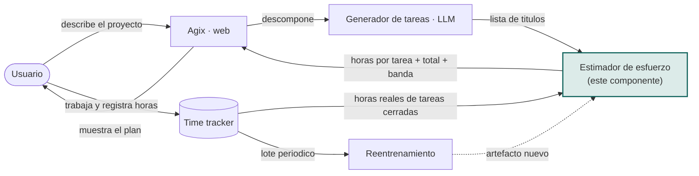

### B.3.2 · Camino de una petición, con las dos rutas

El diagrama que más importa: **las dos preguntas no recorren el mismo camino**.

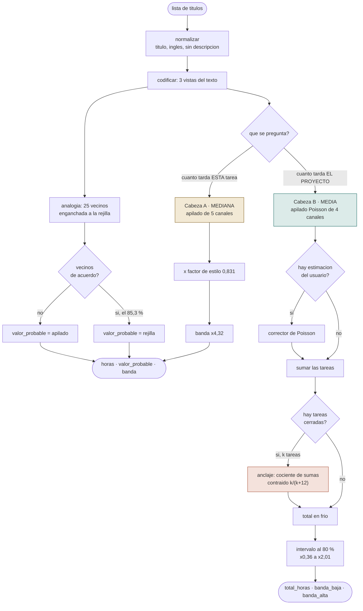

### B.3.3 · Flujo interno del modelo

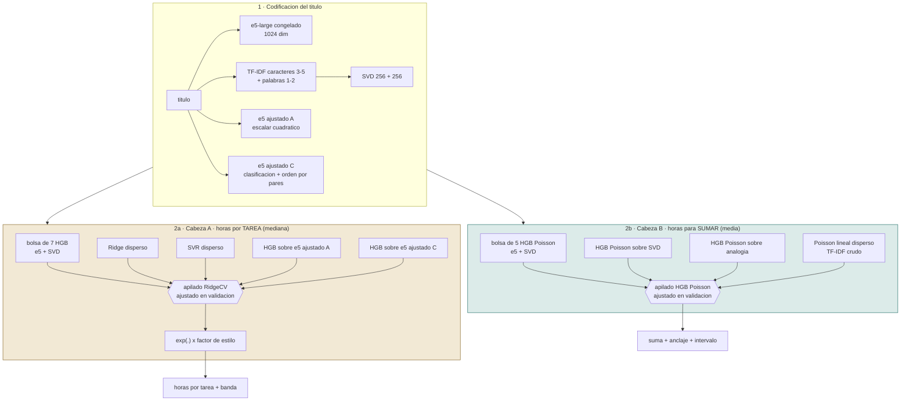

### B.3.4 · Nivel 1 · Contexto

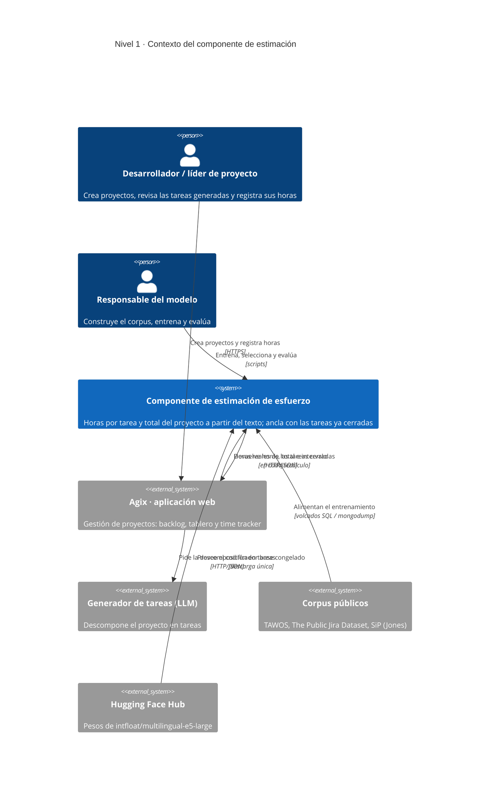

### B.3.5 · Nivel 2 · Contenedores en ejecución

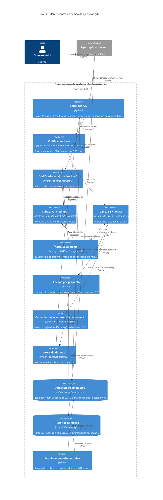

> **Decisión que se ve aquí:** el codificador base está **congelado** y los codificadores
> ajustados **solo hacen falta para la ruta por tarea**. Un despliegue que solo necesite el
> total del proyecto —que es la métrica que se presenta— ahorra **4,4 GB**.

### B.3.6 · Nivel 2b · Tubería de datos y entrenamiento (fuera de línea)

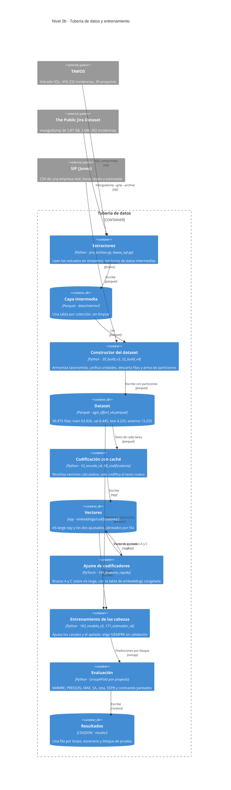

> **Garantías de la partición:** `test` es cronológica dentro de cada proyecto, `externo` son
> **150 proyectos enteros** nunca vistos, y los duplicados se agrupan por hash de texto para que
> no crucen particiones. En la evaluación por proyecto se usa siempre `GroupKFold` **por
> proyecto entero**: partir por tarea filtraría la escala del proyecto al entrenamiento.

### B.3.7 · Orden de reconstrucción

**El orden importa.** Si cambian los pesos de un codificador ajustado, cambian sus vectores, y
la cabeza que los consume queda ajustada sobre los antiguos. Servir con un codificador que no
case con su cabeza **no falla: solo acierta menos**.

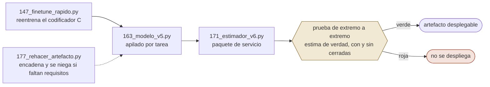

La prueba final no es opcional: **es lo único que demuestra que el artefacto sirve**. La primera
vez que se construyó el v6 parecía correcto y no podía codificar texto nuevo, porque los pesos
del codificador nunca se habían guardado. Lo destapó justamente esa prueba.

### B.3.8 · Vista dinámica · el ciclo de vida de un proyecto

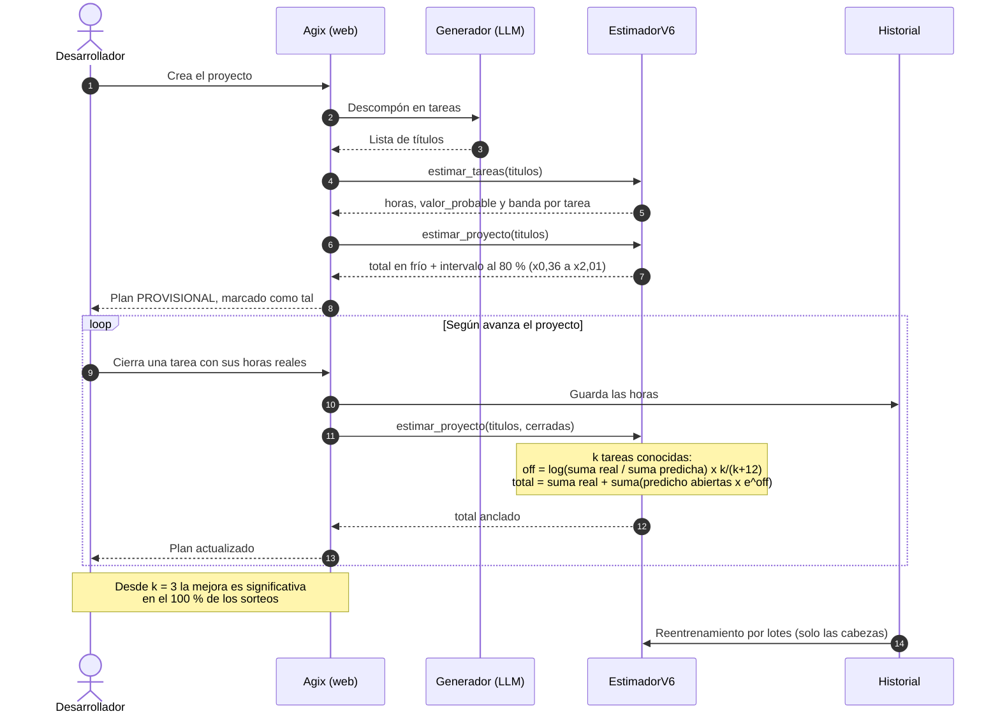

---

## B.4 · Los datos

### El dataset completo

| | |
|---|---|
| fichero | `data/processed/agix_effort_v4.parquet` · 90.975 filas · 52 columnas · 533 proyectos |
| particiones | train 63.926 · val 8.445 · test 4.225 · externo 13.255 (150 proyectos enteros) |
| tareas de software | 89.851 |
| fuentes | TAWOS · The Public Jira Dataset · SiP (Jones) |

### Lo que el modelo usa de verdad

| | |
|---|---|
| subconjunto | tareas de software **sin Apache** |
| tamaño | **24.848 tareas · 204 proyectos** (114 con ≥ 8 tareas, que son la unidad de evaluación) |
| fuentes | TAWOS 9.559 · SiP 7.791 · JiraPublico 7.498 |
| horas | mediana 2,0 h · media 6,11 h · p01 0,09 h · p99 66 h |
| particiones | train 16.648 · val 3.183 · test fija 4.225 · externo 792 |

**Por qué se excluye Apache:** su mediana es 0,67 h contra 2,0 h del trabajo comercial, y
mezclarlo desplaza toda la escala hacia abajo. Se midió (E38) y empeora. Apache sí se usa, pero
**solo como corpus de réplica independiente** para validar conclusiones —186 proyectos,
64.587 tareas— nunca para entrenar.

**Rasgos que el diseño prohíbe usar**, aunque estén en el corpus, porque en producción no
existen cuando se crea la tarea: `source` (Agix sería un nivel no visto), recuentos de enlaces y
de componentes (se acumulan mientras la tarea se trabaja, y valen cero al crearla), y story
points.

---

## B.5 · Arquitectura interna

### B.5.1 · Codificación del título

Tres vistas del mismo texto, porque cada una acierta en cosas distintas:

| vista | qué es | dimensiones |
|---|---|---|
| **semántica** | `intfloat/multilingual-e5-large`, **congelado**, prefijo `query: ` | 1024 |
| **léxica densa** | TF-IDF de caracteres `char_wb` 3–5 (vocab 35.450) + palabras 1–2 (vocab 20.256), `sublinear_tf`, reducidos con SVD | 256 + 256 |
| **léxica dispersa** | el mismo TF-IDF **sin reducir**, para los modelos lineales | ~55.700 |

Además, **dos codificadores ajustados** sobre el mismo `e5-large`, que aportan cosas distintas
y por eso van los dos:

- **A** — ajustado con un escalar de pérdida cuadrática: estima mejor la **escala**.
- **C** — ajustado con cabeza de clasificación sobre la rejilla más una pérdida de **ordenación
  por pares**: **ordena** mejor.

En el ajuste se **congela la tabla de embeddings** (es la mitad de los parámetros y no aporta en
títulos de ~48 piezas), se recorta cada lote a su longitud real y se entrena en bf16.

### B.5.2 · Cabeza A · horas por tarea (la mediana)

Cinco canales apilados con `RidgeCV` (α = 48,3) ajustado **en validación**, no en
entrenamiento, para que los pesos no premien al canal que más sobreajusta:

| canal | peso |
|---|---|
| bolsa de 7 HGB sobre e5 + SVD (85 % de muestras, 80 % de rasgos cada uno) | **+0,280** |
| HGB sobre e5 **ajustado A** | **+0,251** |
| HGB sobre e5 **ajustado C** | **+0,233** |
| Ridge sobre TF-IDF disperso | +0,188 |
| LinearSVR sobre TF-IDF disperso | −0,015 |

El peso negativo del SVR no es un error: el apilado lo usa como **corrección** del Ridge, que ve
los mismos rasgos.

La salida se exponencia y se multiplica por un **factor de estilo de 0,831**. El texto del
generador es más escueto que un título de Jira e infla las predicciones (el sesgo pasa de 1,02 a
1,20 con el mismo contenido reescrito al estilo del generador); el factor lo compensa, ajustado
en un bloque y verificado en el otro.

### B.5.3 · Cabeza B · horas para sumar (la media)

Cuatro canales, **todos con pérdida de Poisson sobre horas** (no sobre log), apilados con un
HGB también de Poisson ajustado en validación:

- bolsa de 5 HGB sobre e5 + SVD
- HGB sobre solo el SVD
- HGB sobre la predicción por analogía
- **`PoissonRegressor` lineal sobre el TF-IDF disperso crudo** (α = 1e−3)

El canal lineal disperso es el que menos se espera y sí aporta: recoge señal léxica literal
(`typo`, `bump`, `readme`) que los árboles sobre vectores densos diluyen.

### B.5.4 · Analogía y rejilla

Para cada tarea se buscan los **25 vecinos más próximos** por coseno entre los 16.648 vectores
de entrenamiento (guardados en `float16`) y se toma la **mediana** de sus horas reales. Ese
número se **engancha a la rejilla** de los 41 valores que aparecen al menos 60 veces en el
entrenamiento:

```
0,083 0,1 0,167 0,25 0,333 0,417 0,5 0,583 0,667 0,7 0,75 0,833 1 1,167 1,25 1,333
1,5 1,75 2 2,25 2,5 2,75 3 3,5 4 4,5 5 5,5 6 6,5 7 8 9 10 11 12 14 16 24 32 40
```

El objetivo está fuertemente cuantizado: la gente registra 1 h, 2 h, medio día. Un modelo de
regresión devuelve 1,83 h y no acierta ninguno de los valores que la gente escribe de verdad.
Cuando los vecinos **están de acuerdo** —desviación de `log(horas)` entre ellos ≤ **1,524**, que
cubre el **85,3 %** de las tareas (medido sin contar la propia tarea como vecina, que es lo que
pasa en servicio)— se muestra el valor de la rejilla como `valor_probable`; si no, la predicción
del apilado. El umbral se eligió maximizando el ±25 % en validación.

---

## B.6 · Los tres mecanismos que usan información del proyecto

### B.6.1 · Anclaje con tareas cerradas — *el mecanismo más valioso del diseño*

Cuando el equipo ya cerró tareas, sus horas son **un dato**, no una estimación:

```python
k     = número de tareas cerradas
off   = log( Σ horas_reales(cerradas) / Σ predicción(cerradas) ) × k / (k + 12)
total = Σ horas_reales(cerradas)  +  Σ predicción(abiertas) × exp(off)
```

Tres decisiones aquí, y **las tres costaron encontrarlas**:

1. **Cociente de sumas**, no mediana de cocientes. Si se estima con la mediana de
   `log(real/predicho)` y el estimador predice la media, esa mediana es sistemáticamente
   negativa. Anclando así, cuantas más tareas cerradas **peor**: con 20 el sesgo llegaba a
   −45,7 %.
2. **Las cerradas se saben, no se estiman.** Sumar la predicción de lo ya cerrado es tirar
   información.
3. **Contracción de James-Stein con λ = 12.** Con `k` pequeño el cociente es ruidoso. Se barrió
   λ de 0 a 24: sin contracción el MdMRE con una tarea cerrada es **0,726** en vez de **0,347**.

**Efecto medido:**

| tareas cerradas | orden de la escala (Spearman) | MdMRE | ±25 % | Wilcoxon vs frío |
|---|---|---|---|---|
| ninguna | 0,444 | 0,355 | 36,8 % | — |
| 3 | **0,700** | 0,319 | 40,7 % | **p = 0,0003 (100 % de sorteos)** |
| 5 | **0,769** | 0,292 | 43,2 % | **p < 0,0001 (100 %)** |

**Y no depende de que el equipo cierre al azar.** Usando el **orden real** de cierre de los 82
proyectos que tienen fecha, el sesgo es −1,6 % (frente a −0,3 % del sorteo) y la exactitud
*mejora*. El único escenario que rompería el anclaje —despachar sistemáticamente lo más corto
primero, −80,5 % con tres cerradas— no ocurre en este corpus y **es observable en producción**.

### B.6.2 · Corrección de la estimación del usuario

Si el formulario pide una estimación, se corrige con un HGB de **Poisson** sobre
`[vector e5 | log(estimación) | log(predicción en frío)]`.

**Tiene que ser el de Poisson.** El corrector de error cuadrático, que es el que sirve por
tarea, **empeora** la estimación cruda del usuario a nivel de proyecto (sesgo −35,5 %). Sobre
los 43 proyectos con estimación en al menos el 80 % de sus tareas, el ±25 % pasa de **44,2 %**
en frío a **65,1 %**.

### B.6.3 · Intervalo del total

Cuantiles empíricos de `log(real / estimado)` sobre los 114 proyectos de evaluación. Al 80 %:
**×0,36 a ×2,01**.

> **Limitación conocida y deliberada:** el intervalo se calcula siempre con los residuos **en
> frío**, aunque haya tareas cerradas. Es decir, **es conservador cuando hay anclaje**: la
> estimación puntual mejora pero la banda no se estrecha. Recalibrar por `k` requeriría más
> proyectos de los que hay.

---

### B.6.4 · Enganche con el generador de backlog

El estimador no recibe texto de Jira en produccion: recibe **lo que escribe el generador
de historias y tareas** de Agix. Son dos repositorios distintos y los une
`src/34_estimacion.py` (en el repositorio del generador), que toma la salida del
generador y le pone horas.

Dos detalles del enganche que no son opcionales:

**1 · Se le pasa el INGLES.** El generador trabaja en ingles internamente y solo traduce
al final, asi que el adaptador usa `h["tareas"]` y nunca `h["tareas_es"]`. Pasarle el
espanol seria salirse del contrato sin que nada fallase: solo acertaria menos.

**2 · El factor de estilo del total NO es el de la mediana (E74).** La cabeza A
multiplica por 0,8313 para compensar que el texto del generador es mas escueto que un
titulo de Jira. La cabeza B no aplica nada, y el factor de la cabeza A no vale: son dos
modelos con perdidas distintas. Medido sobre las 800 tareas reales ya reescritas al
estilo del generador, todas fuera del entrenamiento, con cociente de sumas:

| texto de entrada | suma predicha / suma real |
|---|---|
| titulo original de Jira | **1,0018** — calibrado |
| el mismo contenido en estilo del generador | **1,3775** |
| **factor que lo corrige** | **0,7273** |

Sin esa correccion **el total del proyecto sale un 37 % alto**. Con ella, la media por
tarea de un backlog generado queda en 6,3 h, que es la media del corpus (6,11 h).

El factor se aplica **antes** del anclaje con tareas cerradas, no despues: la contraccion
de James-Stein hace que no se cancele solo.

---

## B.7 · Contrato de la interfaz

```python
est = EstimadorV6()                      # carga models/estimador_agix_v6.joblib

est.estimar_tareas(textos)               # -> DataFrame
#   texto · horas · valor_probable · banda_baja · banda_alta

est.estimar_proyecto(textos,             # -> dict
                     cerradas=None,      #   horas REALES ya registradas; None donde no
                     estimaciones=None,  #   lo que estimó el usuario; None donde no
                     nivel=0.8)
#   total_horas · banda_baja · banda_alta · nivel · tareas · cerradas
```

Reglas del contrato, que importan:

- **El texto se espera en inglés** (`idioma_esperado`), solo el **título** (`vista`), sin
  descripción. El generador de Agix ya produce inglés internamente y traduce solo para mostrar.
- `cerradas` y `estimaciones` son listas **de la misma longitud que `textos`**, con `None` en
  las posiciones que no aplican.
- `horas` es la mediana; `valor_probable` es un valor de la rejilla cuando los vecinos están de
  acuerdo. **Ninguna de las dos es para sumar**: el total sale de `estimar_proyecto`, que usa la
  otra cabeza.

---

## B.8 · Artefactos y rendimiento medido

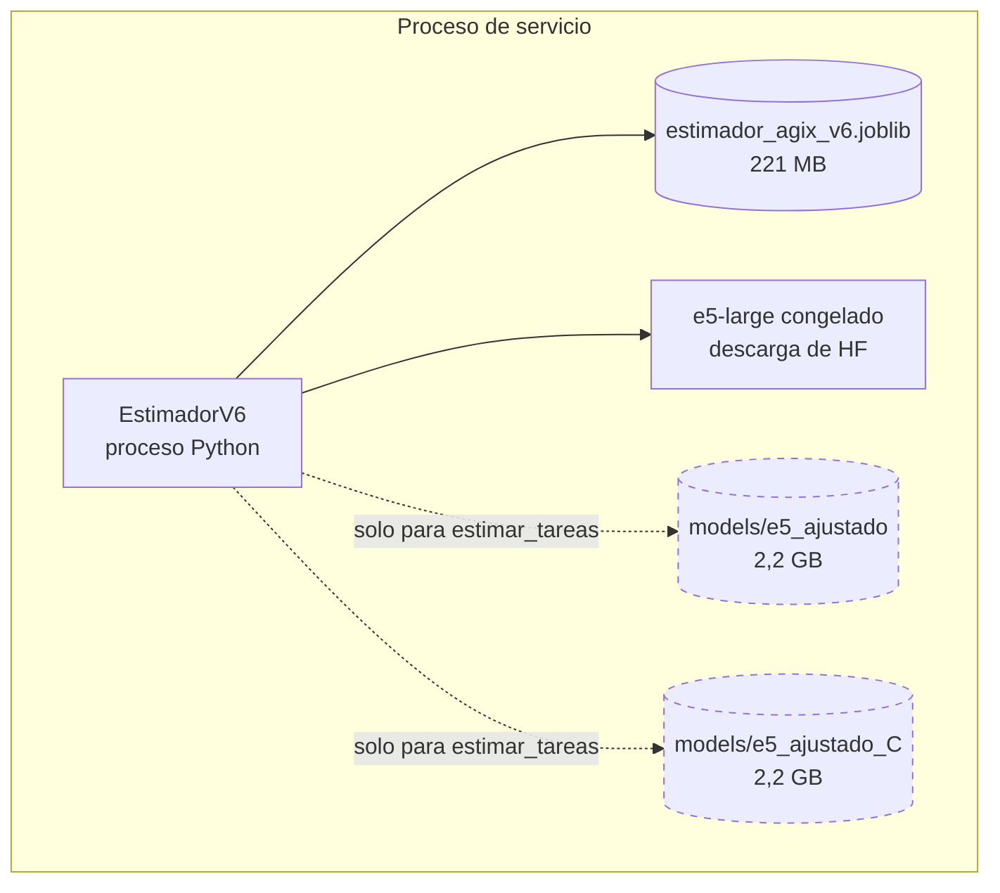

**Los dos codificadores ajustados solo hacen falta para `estimar_tareas`.** La ruta del total
—`estimar_proyecto`, que es la métrica que se presenta— usa **únicamente el codificador base**.
Verificado en proceso limpio: tras estimar un proyecto de 42 tareas, A y C siguen sin cargar.

Medido en este equipo, con GPU CUDA disponible:

| | |
|---|---|
| carga del paquete joblib | **4,5 s** |
| primera llamada a `estimar_tareas` (carga los 3 codificadores) | 44 s |
| primera llamada a `estimar_proyecto` (carga solo el base) | 31 s |
| `estimar_tareas`, lote de 42 | **462 ms · 11 ms/tarea** |
| `estimar_proyecto`, 42 tareas, ya cargado | **200–275 ms** |
| memoria residente del proceso | ~1,9 GB de RAM |

Los pesos de los codificadores viven en VRAM con GPU y no cuentan en esa RAM; en CPU hay que
sumar ~2,2 GB por codificador cargado. La carga es **perezosa**: en servicio conviene
precalentar al arrancar, no en la primera petición del usuario.

> **Optimización pendiente, no aplicada:** el paquete arrastra de la versión 3 una matriz
> `centros` de **68 MB** y los objetos `corrector`, `smearing` y `suma_residual`, que el
> servidor v6 **no usa**. Quitarlos dejaría el artefacto en ~150 MB.

### Por qué un modelo propio y no un LLM en línea

Banco medido sobre 601 tareas contra cuatro LLM locales (`gemma2:9b`, `llama3.1:8b`,
`mistral:7b`, `qwen2.5:7b`) en tres condiciones de prompt, **36 comparaciones pareadas**:

| veredicto | n |
|---|---|
| nuestro modelo mejor | 17 |
| empate | 18 |
| **el LLM mejor** | **1** |

Y el coste no se parece: el LLM tarda **0,31 a 2,45 s por tarea** frente a los **11 ms** medidos
aquí, entre **28× y 223× más lento**. La sonda de contaminación descarta que los LLM reconozcan
las incidencias: ninguno acertó la clave exacta en 450 intentos.

---

## B.9 · Calidad medida

### Total del proyecto — *la métrica que se presenta*

114 proyectos, **todos predichos como si fueran nuevos**:

| | MAE (h) | RMSE | MdMRE | R²log | ±25 % | factor 2 | sesgo |
|---|---|---|---|---|---|---|---|
| constante (no lee el texto) | 886 | 2046 | 0,694 | 0,364 | 8,8 % | 24,6 % | −203 % |
| **en frío** | **455** | 1090 | **0,355** | **0,817** | **36,8 %** | **72,8 %** | −0,3 % |
| **con 5 tareas cerradas** | **379** | 991 | **0,291** | **0,911** | **43,7 %** | **85,5 %** | +0,2 % |
| con 20 tareas cerradas | 291 | 795 | 0,219 | 0,908 | 54,3 % | 87,5 % | +1,5 % |

### Por tarea — prueba fija, 4.225 tareas

| MAE (h) | SA | Δ de Glass | ζ | R²log | ±25 % | factor 2 | Spearman |
|---|---|---|---|---|---|---|---|
| 4,91 | 0,432 | 0,204 | 119 % | 0,202 | 16,1 % | 44,4 % | 0,421 |

### Lo que gana la suma (E73)

Las **mismas** predicciones de la cabeza B, medidas en las dos unidades sobre los mismos 114
proyectos:

| unidad | n | MdMRE | ±25 % | factor 2 |
|---|---|---|---|---|
| por tarea | 24.622 | 1,370 | 12,1 % | 33,1 % |
| **por proyecto** | 114 | **0,355** | **36,8 %** | **72,8 %** |

**Sumar divide el MdMRE por 3,86.** Que la cabeza de la media salga mal por tarea no es un
defecto: con un objetivo asimétrico la media está por encima de la mediana, así que sobreestima
la tarea típica a propósito. Es el precio de poder sumarla, y es exactamente lo que justifica
**dos cabezas y no una** — por eso la columna «horas por tarea» que ve el usuario sale de la
cabeza A, no de esta.

**Lectura honesta:** tarea a tarea el tamaño del efecto frente al azar es **pequeño** (Δ de
Glass 0,204). El valor del modelo está en **el total del proyecto** y en corregir la estimación
del usuario, no en clavar una tarea suelta.

---

## B.10 · Límite conocido: la compresión de la escala

El diagnóstico, en una regresión:

```
log(real) = −0,831 + 1,001·log(nº de tareas) + 1,375·log(tamaño típico de tarea)
```

El **número de tareas se conoce exacto**. El **tamaño típico de tarea** se predice con solo el
**34 %** de su dispersión real (0,271 frente a 0,791). El modelo no puede saber por el texto si
un equipo trabaja en tickets de media hora o en tareas de ocho: **esa información no está en el
título**. De ahí el sesgo monótono por tamaño de tarea, de ×5,36 en proyectos de menos de
0,5 h/tarea a ×0,61 en los de más de 4 h.

**Se intentó corregir por siete vías y ninguna se sostiene:** mapeo de cuantiles, calibración
lineal en log, cambio de etiqueta (BBSE), un modelo de escala de proyecto propio, contraer el
anclaje hacia ese modelo, entrenar la escala con Apache, y una réplica independiente. El
contraste conjunto sobre **300 proyectos de dos corpus reales** (Fisher: Wilcoxon p = 0,24,
McNemar p = 0,67) **no muestra efecto**. Y la compresión **se replica y es peor** en Apache
(cubre el 19 % del recorrido, Spearman 0,108), así que es un fenómeno general y no un artefacto
de este corpus.

**Consecuencia de diseño, y por eso el anclaje es el mecanismo central:** la única información
sobre la escala que el texto no da la aporta **la primera tarea cerrada**.

---

## B.11 · Operación

**Cómo presentarlo en producto.** Mostrar la estimación en frío como **provisional** y
recalcularla en cuanto el equipo cierre las primeras **tres** tareas. No hace falta esperar a
veinte: desde k = 3 la mejora es significativa en el 100 % de los sorteos.

**Qué vigilar.**

| señal | umbral | qué significa |
|---|---|---|
| tareas cerradas por debajo de la mediana del equipo | sistemático | el anclaje se sesgaría a la baja; es el único escenario que lo rompe |
| tamaño típico de tarea del proyecto | < 1 h | zona de sesgo ×1,7 a ×5,4; avisar de que la estimación es poco fiable |
| idioma del título | ≠ inglés | fuera de contrato |

**Reentrenamiento.** Por lotes, con las horas reales que va acumulando el time tracker. El
**codificador base no se toca**; se reajustan las cabezas y, si se rehacen los codificadores
ajustados, hay que repetir la cadena completa en el orden de [B.3.7](#b37--orden-de-reconstrucción).
La evaluación debe mantener siempre `GroupKFold` **por proyecto entero**.

---

## B.12 · Resumen de decisiones de diseño

| decisión | alternativa descartada | por qué |
|---|---|---|
| **dos cabezas**, mediana y media | una sola cabeza | sumar medianas deja el total en el 44 % |
| Poisson sobre horas para el total | log + smearing de Duan | mejora MdMRE, MAE, RMSE, ±50 % y factor 2 a la vez |
| apilado ajustado en **validación** | ajustado en entrenamiento | si no, los pesos premian al canal que más sobreajusta |
| **dos** codificadores ajustados | solo uno | uno ordena mejor y el otro estima mejor la escala |
| codificador base **congelado** | ajustarlo de extremo a extremo | permite cachear vectores y reentrenar solo las cabezas |
| solo el **título**, en inglés | título + descripción | es lo que el generador produce |
| **sin Apache** en entrenamiento | corpus completo | su mediana de 0,67 h desplaza toda la escala |
| cociente de **sumas** para anclar | mediana de cocientes | con la mediana, más tareas cerradas daba **peor** resultado |
| corrector de **Poisson** para el usuario | corrector cuadrático | el cuadrático empeora la estimación cruda del usuario |
| intervalo en frío siempre | recalibrar por k | no hay proyectos suficientes; se prefiere conservador |
| modelo propio | LLM local en línea | gana 17 de 36 comparaciones, empata 18, y es 28–223× más rápido |
