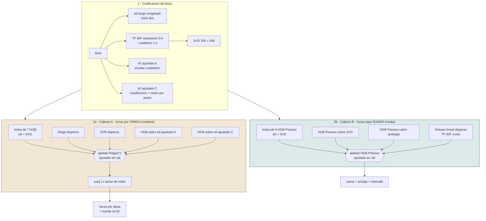
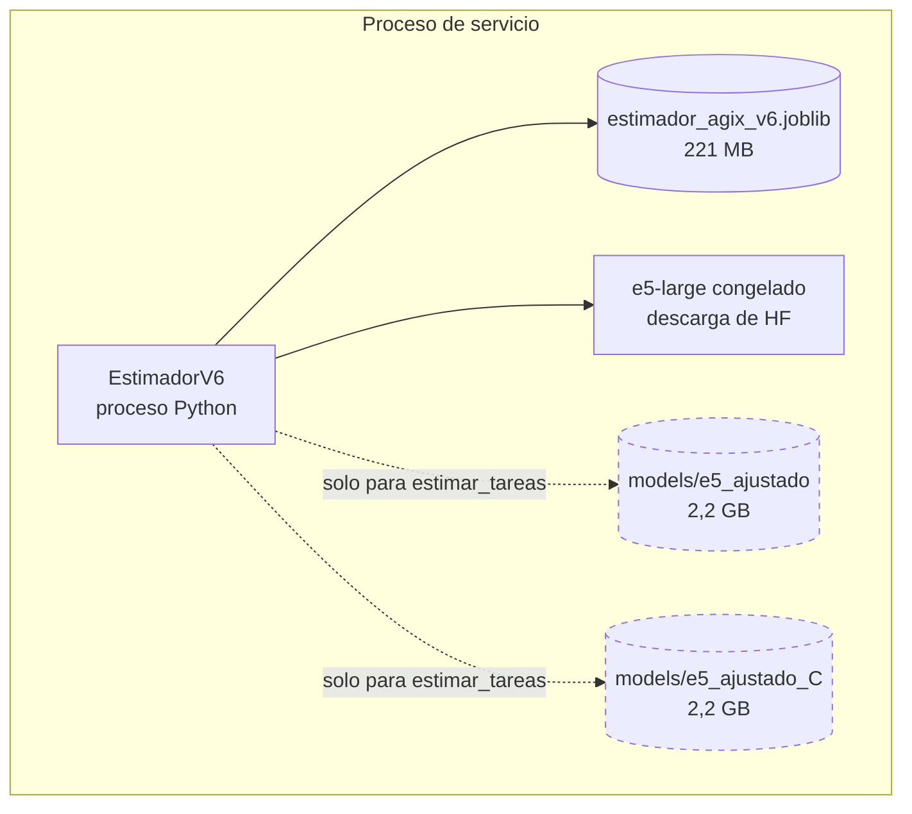

# Diseño de la tubería de estimación de esfuerzo · Agix

**Modelo documentado:** `estimador_agix_v6` · corpus v4 sin Apache · construido el 2026-09-29
**Alcance:** solo el modelo vigente. Las alternativas que se midieron y se descartaron están
en `INFORME_PROYECTO.md`; aquí solo aparecen cuando explican por qué el diseño es así.

> Este documento sustituye a `DIAGRAMAS_C4.md` en todo lo que se refiera al modelo. Aquel
> describe una versión anterior (codificador *mpnet* de 768 dimensiones, `frio_v4.joblib`,
> un solo regresor) que ya no es la desplegada.

---

## 1 · Qué hace y dónde encaja

Agix descompone un proyecto en tareas con un LLM. Este componente recibe **el texto de esas
tareas** y responde **cuántas horas**. Es el arranque en frío: en ese momento no existe
historial del proyecto, solo títulos recién generados.


El componente tiene **dos modos de uso** y una realimentación:

| entrada | salida | cuándo |
|---|---|---|
| lista de títulos | horas por tarea, con banda | al generar el backlog |
| lista de títulos | **total del proyecto** con intervalo al 80 % | al presentar el plan |
| + horas reales de tareas ya cerradas | total **recalculado** | según avanza el proyecto |
| + estimación del usuario | total corregido | si el formulario la pide |

---

## 2 · La decisión que estructura todo: dos preguntas, dos cabezas

**Este es el punto central del diseño y la razón de que el artefacto lleve dos modelos.**

Las dos preguntas del producto no tienen la misma respuesta estadística:

| pregunta | respuesta correcta | por qué |
|---|---|---|
| ¿cuánto tarda **esta** tarea? | la **mediana** condicional | es el número que se le enseña a una persona al lado de una tarea; la mediana minimiza el error absoluto |
| ¿cuánto tarda **el proyecto**? | la **media** condicional | el total es una **suma**, y solo las medias suman |

La distribución de horas es muy asimétrica (mediana 2,0 h, media 6,11 h). Sumar medianas deja
el total en el **44 %** de lo que toca. Por eso hay dos cabezas entrenadas con **pérdidas
distintas** sobre los mismos rasgos:

- **Cabeza A — por tarea:** error cuadrático sobre `log(horas)` → mediana condicional.
- **Cabeza B — para sumar:** **pérdida de Poisson sobre horas** → media condicional directa.

Antes esto se resolvía de segunda mano, empujando la mediana con el estimador de *smearing*
de Duan (1983). Funcionaba, pero entrenar directamente para el objetivo correcto es mejor en
MdMRE, MAE, RMSE, ±50 % y factor 2 a la vez. El factor de smearing sigue guardado en el
artefacto por trazabilidad, pero **el servidor v6 no lo usa**.

---

## 3 · Contrato de la interfaz

```python
est = EstimadorV6()                      # carga models/estimador_agix_v6.joblib

est.estimar_tareas(textos)               # -> DataFrame
#   texto · horas · valor_probable · banda_baja · banda_alta

est.estimar_proyecto(textos,             # -> dict
                     cerradas=None,      #   horas REALES ya registradas; None donde no
                     estimaciones=None,  #   lo que estimo el usuario; None donde no
                     nivel=0.8)
#   total_horas · banda_baja · banda_alta · nivel · tareas · cerradas
```

Reglas del contrato, que importan:

- **El texto se espera en inglés** (`idioma_esperado`), solo el **título** (`vista`), sin
  descripción. El generador de Agix ya produce inglés internamente y traduce solo para
  mostrar; alimentar el estimador con el inglés no cuesta nada.
- `cerradas` y `estimaciones` son listas **de la misma longitud que `textos`**, con `None` en
  las posiciones que no aplican.
- `horas` es la mediana; `valor_probable` es un valor de la rejilla de valores frecuentes
  cuando los vecinos están de acuerdo, y `horas` cuando no. Son para enseñar, **no para
  sumar**: el total sale de `estimar_proyecto`, que usa la otra cabeza.

---

## 4 · Los datos de los que sale

| | |
|---|---|
| corpus | `data/processed/agix_effort_v4.parquet`, tareas de software, **sin Apache** |
| tamaño | **24.848 tareas · 204 proyectos** (114 con ≥ 8 tareas, que son la unidad de evaluación) |
| fuentes | TAWOS 9.559 · SiP 7.791 · JiraPublico 7.498 |
| horas | mediana 2,0 h · media 6,11 h · p01 0,09 h · p99 66 h |
| particiones | train 16.648 · val 3.183 · test fija 4.225 · externo 792 |

**Por qué se excluye Apache:** su mediana es 0,67 h contra 2,0 h del trabajo comercial.
Mezclarlo desplaza toda la escala hacia abajo. Se midió (E38) y empeora. Apache sí se usa,
pero solo como **corpus de réplica independiente** para validar conclusiones, nunca para
entrenar.

**Rasgos que el diseño prohíbe usar**, aunque estén en el corpus, porque en producción no
existen cuando se crea la tarea: `source` (Agix sería un nivel no visto), recuentos de
enlaces y de componentes (se acumulan mientras la tarea se trabaja, y valen cero al crearla),
y story points.

---

## 5 · Arquitectura



### 5.1 · Codificación del título

Tres vistas del mismo texto, porque cada una acierta en cosas distintas:

| vista | qué es | dimensiones |
|---|---|---|
| **semántica** | `intfloat/multilingual-e5-large`, **congelado**, prefijo `query: ` | 1024 |
| **léxica densa** | TF-IDF de caracteres `char_wb` 3–5 (vocab 35.450) + palabras 1–2 (vocab 20.256), `sublinear_tf`, reducidos con SVD | 256 + 256 |
| **léxica dispersa** | el mismo TF-IDF **sin reducir**, para los modelos lineales | ~55.700 |

Además, **dos codificadores ajustados** sobre el mismo `e5-large`, que aportan cosas
distintas y por eso van los dos:

- **A** — ajustado con un escalar de pérdida cuadrática: estima mejor la **escala**.
- **C** — ajustado con cabeza de clasificación sobre la rejilla más una pérdida de
  **ordenación por pares**: **ordena** mejor.

### 5.2 · Cabeza A · horas por tarea

Cinco canales apilados con `RidgeCV` (α = 48,3) ajustado **en validación**, no en
entrenamiento, para que los pesos no premien al canal que más sobreajusta:

| canal | peso |
|---|---|
| bolsa de 7 HGB sobre e5 + SVD (85 % de muestras, 80 % de rasgos cada uno) | **+0,280** |
| HGB sobre e5 **ajustado A** | **+0,251** |
| HGB sobre e5 **ajustado C** | **+0,233** |
| Ridge sobre TF-IDF disperso | +0,188 |
| LinearSVR sobre TF-IDF disperso | −0,015 |

El peso negativo del SVR no es un error: el apilado lo usa como **corrección** del Ridge, que
ve los mismos rasgos.

La salida se exponencia y se multiplica por un **factor de estilo de 0,831**. El texto del
generador es más escueto que un título de Jira e infla las predicciones (el sesgo pasa de
1,02 a 1,20 con el mismo contenido reescrito al estilo del generador); el factor lo compensa,
ajustado en un bloque y verificado en el otro.

### 5.3 · Cabeza B · horas para sumar

Cuatro canales, **todos con pérdida de Poisson sobre horas** (no sobre log), apilados con un
HGB también de Poisson ajustado en validación:

- bolsa de 5 HGB sobre e5 + SVD
- HGB sobre solo el SVD
- HGB sobre la predicción por analogía
- **`PoissonRegressor` lineal sobre el TF-IDF disperso crudo** (α = 1e−3)

El canal lineal disperso es el que menos se espera y sí aporta: recoge señal léxica literal
(`typo`, `bump`, `readme`) que los árboles sobre vectores densos diluyen.

### 5.4 · Analogía y rejilla

Para cada tarea se buscan los **25 vecinos más próximos** por coseno entre los 16.648
vectores de entrenamiento (guardados en `float16`) y se toma la **mediana** de sus horas
reales. Ese número se **engancha a la rejilla** de los 41 valores que aparecen al menos 60
veces en el entrenamiento:

```
0,083 0,1 0,167 0,25 0,333 0,417 0,5 0,583 0,667 0,7 0,75 0,833 1 1,167 1,25 1,333
1,5 1,75 2 2,25 2,5 2,75 3 3,5 4 4,5 5 5,5 6 6,5 7 8 9 10 11 12 14 16 24 32 40
```

El objetivo está fuertemente cuantizado: la gente registra 1 h, 2 h, medio día. Un modelo de
regresión devuelve 1,83 h y no acierta ninguno de los valores que la gente escribe de verdad.
Cuando los vecinos **están de acuerdo** —desviación de `log(horas)` entre ellos ≤ **1,524**,
que cubre el **85,3 %** de las tareas (medido sin contar la propia tarea como vecina, que es
lo que pasa en servicio)— se muestra el valor de la rejilla como `valor_probable`; si no, se
muestra la predicción del apilado. El umbral se eligió maximizando el ±25 % en validación.

---

## 6 · Los tres mecanismos que usan información del proyecto

### 6.1 · Anclaje con tareas cerradas — *el mecanismo más valioso del diseño*

Cuando el equipo ya cerró tareas, sus horas son **un dato**, no una estimación. El total es
lo conocido más lo que queda, corregido por el desajuste observado:

```python
k    = número de tareas cerradas
off  = log( Σ horas_reales(cerradas) / Σ predicción(cerradas) ) × k / (k + 12)
total = Σ horas_reales(cerradas)  +  Σ predicción(abiertas) × exp(off)
```

Tres decisiones aquí, y **las tres costaron encontrarlas**:

1. **Cociente de sumas**, no mediana de cocientes. Si se estima con la mediana de
   `log(real/predicho)` y el estimador predice la media, esa mediana es sistemáticamente
   negativa. Anclando así, cuantas más tareas cerradas **peor**: con 20 el sesgo llegaba a
   −45,7 %.
2. **Las cerradas se saben, no se estiman.** Sumar la predicción de lo ya cerrado es tirar
   información.
3. **Contracción de James-Stein con λ = 12.** Con `k` pequeño el cociente es ruidoso; el
   factor `k/(k+12)` lo encoge hacia cero. Se barrió λ de 0 a 24: sin contracción el MdMRE
   con una tarea cerrada es 0,726 en vez de 0,347.

**Efecto medido:** el orden de la escala del proyecto (Spearman) pasa de **0,444** en frío a
**0,700** con 3 tareas cerradas y **0,769** con 5, con Wilcoxon p ≤ 0,0003 en el 100 % de los
sorteos desde k = 3.

**Y no depende de que el equipo cierre al azar.** Usando el **orden real** de cierre de los 82
proyectos que tienen fecha, el sesgo es −1,6 % (frente a −0,3 % del sorteo) y la exactitud
*mejora*. El único escenario que rompería el anclaje —despachar sistemáticamente lo más corto
primero, −80,5 % con tres cerradas— no ocurre en este corpus y **es observable en producción**:
basta vigilar si las primeras tareas cerradas quedan por debajo de la mediana del equipo.

### 6.2 · Corrección de la estimación del usuario

Si el formulario pide una estimación, se corrige con un HGB de **Poisson** sobre
`[vector e5 | log(estimación) | log(predicción en frío)]`.

**Tiene que ser el de Poisson.** El corrector de error cuadrático, que es el que sirve por
tarea, **empeora** la estimación cruda del usuario a nivel de proyecto (sesgo −35,5 %). Sobre
los 43 proyectos con estimación en al menos el 80 % de sus tareas, el ±25 % pasa de **44,2 %**
en frío a **65,1 %**.

### 6.3 · Intervalo del total

Cuantiles empíricos de `log(real / estimado)` sobre los 114 proyectos de evaluación. Al 80 %:
**×0,36 a ×2,01**.

> **Limitación conocida y deliberada:** el intervalo se calcula siempre con los residuos **en
> frío**, aunque haya tareas cerradas. Es decir, **es conservador cuando hay anclaje**: la
> estimación puntual mejora pero la banda no se estrecha. Recalibrar por `k` requeriría más
> proyectos de los que hay.

---

## 7 · Componentes desplegados y rendimiento medido



**Los dos codificadores ajustados solo hacen falta para `estimar_tareas`.** La ruta del total
del proyecto —`estimar_proyecto`, que es la métrica que se presenta— usa **únicamente el
codificador base**. Verificado en proceso limpio: tras estimar un proyecto de 42 tareas, los
codificadores A y C siguen sin cargar. Un despliegue que solo necesite totales **ahorra 4,4 GB**.

Medido en este equipo (GPU CUDA disponible):

| | |
|---|---|
| carga del paquete joblib | **4,5 s** |
| primera llamada a `estimar_tareas` (carga los 3 codificadores) | 44 s |
| primera llamada a `estimar_proyecto` (carga solo el base) | 31 s |
| `estimar_tareas`, lote de 42 | **462 ms · 11 ms/tarea** |
| `estimar_proyecto`, 42 tareas, ya cargado | **200–275 ms** |
| memoria residente del proceso | ~1,9 GB de RAM |

Medido con GPU disponible, así que los pesos de los codificadores viven en VRAM y no cuentan en esa RAM. En CPU hay que sumarlos: ~2,2 GB por codificador cargado.

La carga es **perezosa**: un codificador se carga la primera vez que se necesita. En servicio
conviene precalentarlo al arrancar, no en la primera petición del usuario.

> **Optimización pendiente, no aplicada:** el paquete arrastra de la versión 3 una matriz
> `centros` de **68 MB** y los objetos `corrector`, `smearing` y `suma_residual`, que el
> servidor v6 **no usa**. Quitarlos dejaría el artefacto en ~150 MB. No se ha tocado para no
> rehacer la cadena a estas alturas.

### Reconstrucción

El orden importa: si cambian los pesos de un codificador ajustado, cambian sus vectores, y la
cabeza que los consume queda ajustada sobre los antiguos. Servir con un codificador que no
case con su cabeza **no falla, solo acierta menos**.

```
147_finetune_rapido.py  →  163_modelo_v5.py  →  171_estimador_v6.py
   (codificador C)          (apilado por tarea)     (paquete de servicio)
```

`177_rehacer_artefacto.py` encadena los dos últimos pasos, se niega a correr si faltan
requisitos, y termina con una **prueba de extremo a extremo** que estima de verdad, con y sin
tareas cerradas. Esa prueba es lo único que demuestra que el artefacto sirve: la primera vez
que se construyó el v6 parecía correcto y no podía codificar texto nuevo, porque los pesos del
codificador nunca se habían guardado.

---

## 8 · Calidad medida

### Total del proyecto — *la métrica que se presenta*

114 proyectos, **todos predichos como si fueran nuevos**:

| | MAE (h) | RMSE | MdMRE | R²log | ±25 % | factor 2 | sesgo |
|---|---|---|---|---|---|---|---|
| constante (no lee el texto) | 886 | 2046 | 0,694 | 0,364 | 8,8 % | 24,6 % | −203 % |
| **en frío** | **455** | 1090 | **0,355** | **0,817** | **36,8 %** | **72,8 %** | −0,3 % |
| **con 5 tareas cerradas** | **379** | 991 | **0,291** | **0,911** | **43,7 %** | **85,5 %** | +0,2 % |
| con 20 tareas cerradas | 291 | 795 | 0,219 | 0,908 | 54,3 % | 87,5 % | +1,5 % |

### Por tarea — prueba fija, 4.225 tareas

| MAE (h) | SA | Δ de Glass | ζ | R²log | ±25 % | factor 2 | Spearman |
|---|---|---|---|---|---|---|---|
| 4,91 | 0,432 | 0,204 | 119 % | 0,202 | 16,1 % | 44,4 % | 0,421 |

### Lo que gana la suma (E73)

Las **mismas** predicciones de la cabeza B, medidas en las dos unidades sobre los mismos
114 proyectos:

| unidad | n | MdMRE | ±25 % | factor 2 |
|---|---|---|---|---|
| por tarea | 24.622 | 1,370 | 12,1 % | 33,1 % |
| **por proyecto** | 114 | **0,355** | **36,8 %** | **72,8 %** |

**Sumar divide el MdMRE por 3,86.** Que la cabeza de la media salga mal por tarea no es un
defecto: con un objetivo asimétrico la media está por encima de la mediana, así que
sobreestima la tarea típica a propósito. Es el precio de poder sumarla, y es exactamente lo
que justifica que el artefacto lleve **dos cabezas y no una** — por eso la columna «horas por
tarea» que ve el usuario sale de la cabeza A, no de esta.

**Lectura honesta:** tarea a tarea el tamaño del efecto frente al azar es **pequeño**
(Δ de Glass 0,204). El valor del modelo está en **el total del proyecto** y en corregir la
estimación del usuario, no en clavar una tarea suelta.

---

## 9 · Límite conocido: la compresión de la escala

El diagnóstico, en una regresión:

```
log(real) = −0,831 + 1,001·log(nº de tareas) + 1,375·log(tamaño típico de tarea)
```

El **número de tareas se conoce exacto**. El **tamaño típico de tarea** se predice con solo el
**34 %** de su dispersión real (0,271 frente a 0,791). El modelo no puede saber por el texto si
un equipo trabaja en tickets de media hora o en tareas de ocho horas: **esa información no
está en el título**. De ahí el sesgo monótono por tamaño de tarea, de ×5,36 en proyectos de
menos de 0,5 h/tarea a ×0,61 en los de más de 4 h.

**Se intentó corregir por siete vías y ninguna se sostiene:** mapeo de cuantiles, calibración
lineal en log, cambio de etiqueta (BBSE), un modelo de escala de proyecto propio, contraer el
anclaje hacia ese modelo, entrenar la escala con Apache, y una réplica independiente. El
contraste conjunto sobre **300 proyectos de dos corpus reales** (Fisher: Wilcoxon p = 0,24,
McNemar p = 0,67) **no muestra efecto**. Y la compresión **se replica y es peor** en Apache
(cubre el 19 % del recorrido, Spearman 0,108), así que es un fenómeno general y no un
artefacto de este corpus.

**Consecuencia de diseño, y por eso el anclaje es el mecanismo central:** la única información
sobre la escala que el texto no da la aporta **la primera tarea cerrada**.

---

## 10 · Operación

**Cómo presentarlo en producto.** Mostrar la estimación en frío como **provisional** y
recalcularla en cuanto el equipo cierre las primeras **tres** tareas. No hace falta esperar a
veinte: desde k = 3 la mejora es significativa en el 100 % de los sorteos.

**Qué vigilar.**

| señal | umbral | qué significa |
|---|---|---|
| tareas cerradas por debajo de la mediana del equipo | sistemático | el anclaje se sesgaría a la baja; es el único escenario que lo rompe |
| tamaño típico de tarea del proyecto | < 1 h | zona de sesgo ×1,7 a ×5,4; avisar de que la estimación es poco fiable |
| idioma del título | ≠ inglés | fuera de contrato |

**Reentrenamiento.** Por lotes, con las horas reales que va acumulando el time tracker. El
**codificador base no se toca**; se reajustan las cabezas y, si se rehacen los codificadores
ajustados, hay que rehacer la cadena entera en el orden de la sección 7. La evaluación debe
mantener siempre `GroupKFold` **por proyecto entero** —nunca por tarea— porque las tareas de
un mismo proyecto comparten escala y partirlas por tarea filtra esa información.

---

## 11 · Resumen de las decisiones de diseño

| decisión | alternativa descartada | por qué |
|---|---|---|
| **dos cabezas**, mediana y media | una sola cabeza | sumar medianas deja el total en el 44 % |
| Poisson sobre horas para el total | log + smearing de Duan | mejora MdMRE, MAE, RMSE, ±50 % y factor 2 a la vez |
| apilado ajustado en **validación** | ajustado en entrenamiento | si no, los pesos premian al canal que más sobreajusta |
| **dos** codificadores ajustados | solo uno | uno ordena mejor y el otro estima mejor la escala |
| solo el **título**, en inglés | título + descripción | es lo que el generador produce; se midió y la descripción no compensa |
| **sin Apache** en entrenamiento | corpus completo | su mediana de 0,67 h desplaza toda la escala |
| cociente de **sumas** para anclar | mediana de cocientes | con la mediana, más tareas cerradas daba **peor** resultado |
| corrector de **Poisson** para el usuario | corrector cuadrático | el cuadrático empeora la estimación cruda del usuario |
| intervalo en frío siempre | recalibrar por k | no hay proyectos suficientes; se prefiere conservador |
