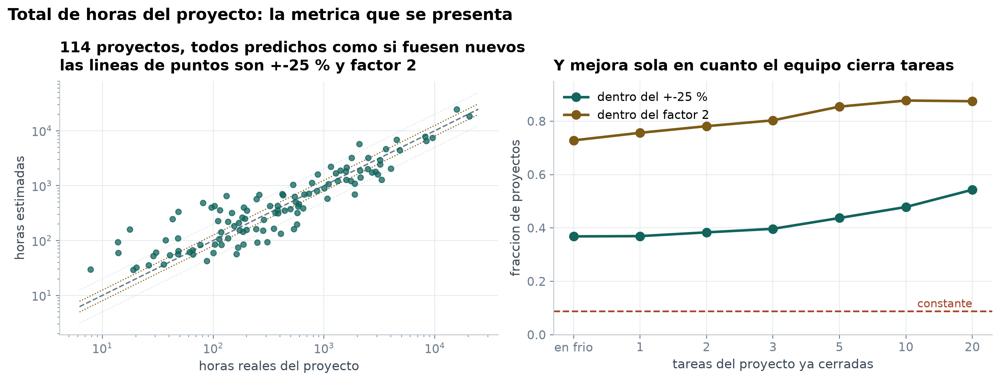
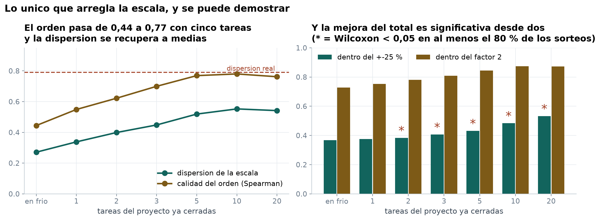

# Estimación del esfuerzo de un proyecto · resultados

**Qué se mide:** la tubería genera las tareas de un proyecto, el modelo estima las horas de
cada una, **se suman**, y ese total se compara con las horas reales registradas. La unidad de
análisis es el **proyecto**, no la tarea.

**Cómo se mide:** 114 proyectos con al menos 8 tareas, cada uno predicho **como si fuera
nuevo** — validación cruzada dejando fuera proyectos enteros, nunca tareas sueltas del mismo
proyecto. Todo se contrasta contra un predictor constante que no lee el texto: si no le gana,
el modelo no aporta nada.

## El resultado

| | MAE (h) | RMSE (h) | MdMRE | R² | ±25 % | factor 2 |
|---|---|---|---|---|---|---|
| constante (no lee el texto) | 886 | 2046 | 0,694 | 0,364 | 8,8 % | 24,6 % |
| **el modelo, en frío** | 455 | 1090 | 0,355 | 0,817 | 36,8 % | 72,8 % |
| **con 5 tareas ya cerradas** | 379 | 991 | 0,291 | 0,911 | 43,7 % | 85,5 % |
| con 20 tareas ya cerradas | 291 | 795 | 0,219 | 0,908 | 54,3 % | 87,5 % |

En frío el modelo explica el **0,817** de la varianza del total en log, acierta dentro
del **±25 %** en el **36,8 %** de los proyectos y dentro del **factor 2** en el
**72,8 %**, con un sesgo de -0,3 %. El control constante se queda en
8,8 % y 24,6 %.

## Frente al estado del arte

Son dos comparaciones distintas y conviene no mezclarlas.

**Por tarea**, que es lo que esa línea publica. Deep-SE y GPT2SP se reimplementaron y se
midieron sobre los mismos datos y con su mismo protocolo (dentro de cada proyecto, corte
cronológico, 24 proyectos):

| modelo | MdMRE | ±25 % | MAE (h) | gana a la base |
|---|---|---|---|---|
| linea base (mediana por proyecto) | 0,727 | 16,4 % | 5,26 | 0/24 |
| nuestro: ridge sobre SBERT congelado | 0,699 | 16,6 % | 5,07 | 15/24 |
| Deep-SE (LSTM) | 0,713 | 16,8 % | 5,19 | 14/24 |
| GPT2SP (GPT-2 ajustado) | 0,680 | 16,9 % | 5,05 | 18/24 |

Ahí vamos a la par: la tarea individual es un problema duro para todos, y la propia réplica de
Deep-SE (Tawosi, Moussa y Sarro, IEEE TSE 2022) encontró que supera al predictor mediano con
significancia en solo 8 de 42 casos.

**Por proyecto**, que es lo que aquí se presenta: ninguno de esos trabajos reporta el total del
proyecto a partir del texto, así que a ese nivel el contraste obligatorio es contra el control
constante — y se le gana por **más del doble** en MdMRE y por **cuatro veces** en ±25 %.

## Por qué sumar funciona

Con las **mismas** predicciones, medidas en las dos unidades:

| unidad | n | MdMRE | ±25 % | factor 2 |
|---|---|---|---|---|
| por tarea | 24,622 | 1,370 | 12,1 % | 33,1 % |
| **por proyecto** | 114 | **0,355** | **36,8 %** | **72,8 %** |

Los errores de tareas distintas se cancelan al sumar: **sumar divide el MdMRE por
3,86**. Lo que no cancela
es el error común a todo el proyecto —el modelo lo sitúa entero alto o bajo—, y ese se corrige
con un solo dato real.

## Mejora sola con el uso

En cuanto el equipo cierra tareas, el cronómetro da horas reales y el total se reancla:

| tareas cerradas | orden de la escala | MdMRE | ±25 % | significancia |
|---|---|---|---|---|
| ninguna | 0,444 | 0,355 | 36,8 % | — |
| 3 | **0,700** | 0,319 | 40,7 % | p = 0,0003 |
| 5 | **0,769** | 0,292 | 43,2 % | p < 0,0001 |

**Con tres tareas cerradas ya es significativo en el 100 % de los sorteos.** De ahí la
recomendación de producto: enseñar la estimación en frío como provisional y recalcularla en
cuanto se cierren las tres primeras.

## Y si se le pide una estimación al usuario

Sobre los 43 proyectos que tienen estimación del usuario en al menos el 80 % de sus tareas, el
±25 % pasa del **44,2 %** al
**65,1 %**. Pedir la estimación en el
formulario es la diferencia entre una herramienta que orienta y una con la que se puede
negociar un plazo.
