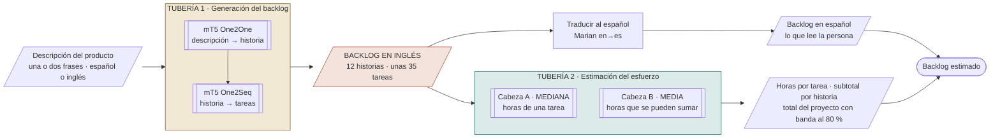
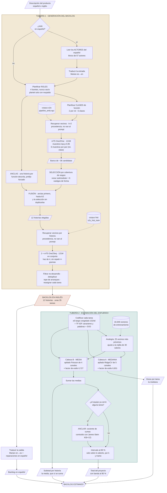
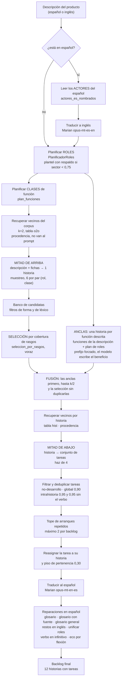
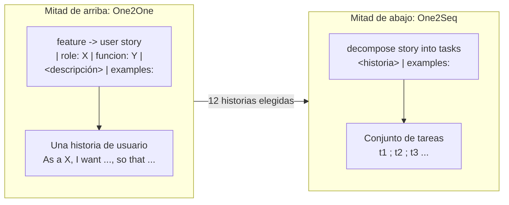
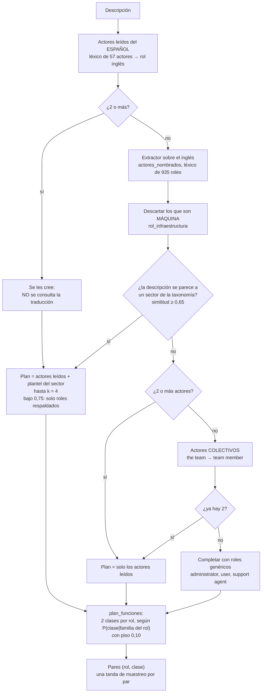
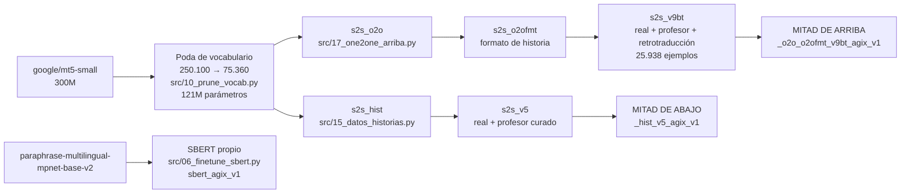

# Diseño · Tubería de generación de historias y tareas

> **Qué es este documento.** Un recorte de `DISENO_PIPELINE.md`, que une el diseño de las dos
> tuberías encadenadas de Agix. Aquí está todo lo que toca a la **generación**: la vista de
> conjunto, la Parte A íntegra, y las dos secciones del estimador que el generador necesita
> porque el adaptador vive en **este** repositorio.
>
> Lo que **no** está: las tripas del estimador de esfuerzo (arquitectura interna, anclaje,
> bandas, calibración). Eso está en el documento completo, Parte B.

---

**De una descripción de producto a un backlog con horas estimadas.**

Son **dos tuberías encadenadas**, cada una con sus modelos, sus datos y su evaluación, y este
documento las reúne en uno solo:

| | qué hace | modelos | estado |
|---|---|---|---|
| **Tubería 1 · Generación** | descripción → historias de usuario con sus tareas | 3 × mT5-small podado (121 M) + SBERT propio + Marian | desplegado 28/09/2026, revisado 21/10/2026 |
| **Tubería 2 · Estimación** | tareas → horas, y el total del proyecto | e5-large congelado (ONNX int8, 397 MB) + dos apilados | `estimador_agix_v7`, 21/10/2026 |

> **Alcance:** solo el diseño vigente de las dos tuberías. El camino de los experimentos
> descartados está en `ROL_FUNCION_LITERATURA.md`, `AUMENTO_DATOS_LITERATURA.md` (generación) y
> `INFORME_PROYECTO.md` (estimación). La demo web no se documenta aquí: es una envoltura, no
> parte de la tubería.

Los diagramas aparecen en **Mermaid** (se ven en GitHub y en VS Code) y, los de la generación,
también como **figura exportada** en SVG vectorial y PNG a 300 dpi para pegar en la memoria.

---

## Índice

**Parte 0 · La tubería completa**
- [0.1 De punta a punta](#01--de-punta-a-punta)
- [0.2 Figura A — Diagrama de flujo simple](#02--figura-a--diagrama-de-flujo-simple)
- [0.3 Figura B — La tubería completa en detalle](#03--figura-b--la-tubería-completa-en-detalle)
- [0.4 El contrato entre las dos tuberías](#04--el-contrato-entre-las-dos-tuberías)

**Parte A · Generación de historias y tareas** — [A.1](#a1-qué-hace-y-qué-decide-el-diseño) ·
[A.2 las siete decisiones](#a2-las-siete-decisiones-de-diseño) · [A.3 flujo](#a3-figura-1--flujo-de-extremo-a-extremo) ·
[A.4 etapas](#a4-detalle-de-cada-etapa) · [A.5 las dos mitades](#a5-figura-2--las-dos-mitades) ·
[A.6 plan de roles](#a6-figura-3--el-plan-de-roles-y-las-fichas-de-control) ·
[A.7 procedencia](#a7-figura-4--procedencia-de-datos-y-modelos) · [A.8 artefactos](#a8-artefactos-que-se-cargan-en-ejecución) ·
[A.9 configuración](#a9-configuración-desplegada) · [A.10 reproducir](#a10-cómo-reproducir-desde-cero) ·
[A.11 evaluación](#a11-protocolo-de-evaluación) · [A.12 resultados](#a12-resultados) ·
[A.13 lo que queda mal](#a13-lo-que-queda-mal-y-las-vías-cerradas) · [A.14 archivos](#a14-mapa-de-archivos)

**Parte B · Estimación de esfuerzo** — [B.1](#b1--qué-hace-y-en-una-tabla) ·
[B.2 dos cabezas](#b2--la-decisión-que-estructura-todo-dos-cabezas) · [B.3 diagramas](#b3--diagramas-de-flujo) ·
[B.4 datos](#b4--los-datos) · [B.5 arquitectura](#b5--arquitectura-interna) ·
[B.6 mecanismos de proyecto](#b6--los-tres-mecanismos-que-usan-información-del-proyecto) ·
[B.7 contrato](#b7--contrato-de-la-interfaz) · [B.8 artefactos y rendimiento](#b8--artefactos-y-rendimiento-medido) ·
[B.9 calidad](#b9--calidad-medida) · [B.10 límite conocido](#b10--límite-conocido-la-compresión-de-la-escala) ·
[B.11 descartes](#b11--lo-que-se-midió-y-se-descartó) · [B.12 trampas](#b12--dos-trampas-de-medición-que-conviene-no-repetir) · [B.13 operación](#b13--operación) · [B.14 decisiones](#b14--resumen-de-decisiones-de-diseño)

---

## 0.1 · De punta a punta

**Entrada**: una descripción de producto en español o en inglés, de una o dos frases.
**Salida**: **12 historias de usuario** en formato «Como X, quiero Y, para Z», cada una con sus
**tareas en español**, cada tarea con sus **horas**, y el **total del proyecto con un intervalo**.

| | coste medido |
|---|---|
| Tubería 1 · generar el backlog | ~26 s en RTX 5060 · ~33 s en CPU |
| Tubería 2 · estimar las horas | **5 s en CPU** para unas 35 tareas |
| carga de los modelos, una sola vez | ~20 s + ~2 s |

Ninguna de las dos llama a un servicio externo: todo corre en la máquina.

---

## 0.2 · Figura A — Diagrama de flujo simple

Lo mínimo que hay que entender: **qué entra y qué sale de cada tubería**, y que lo que la segunda
consume es el **inglés** de la primera, no su traducción.



**Las formas dicen qué es cada cosa**, y se mantienen en las dos figuras:

| forma | significa | ejemplo |
|---|---|---|
| `[/paralelogramo/]` | **datos** que entran o salen | la descripción, el backlog, las horas |
| `[[subrutina]]` | un **modelo** entrenado | los dos mT5, las dos cabezas |
| `[rectángulo]` | un **paso de proceso** sin modelo | traducir, deduplicar, sumar |
| `{rombo}` | una **decisión** | ¿está en español?, ¿hay tareas cerradas? |
| `[(cilindro)]` | un **almacén** que se consulta | los corpus de vecinos |
| `([estadio])` | principio y **final** | el backlog estimado |

**El punto que más importa de esta figura**: el nodo rojo del centro es a la vez **la salida de la
tubería 1 y la entrada de la tubería 2**, y está **en inglés**. La traducción al español es una
rama lateral, solo para mostrar. Pasarle el español al estimador no fallaría; simplemente
acertaría menos, porque su contrato pide inglés.

---

## 0.3 · Figura B — La tubería completa en detalle

Las mismas dos tuberías con todas sus etapas reales.



Tres cosas que esta figura hace explícitas y que son todo el diseño:

1. **La tubería 1 genera; el pipeline decide.** El modelo de arriba produce ~36 candidatas y la
   selección por cobertura elige 12. La calidad no sale del modelo, sale de la elección. Lo único
   que se fuerza es que cada función que la descripción nombra tenga su historia (las anclas,
   A.2.6), porque lo que el modelo no genera no se puede elegir.
2. **La tubería 2 tiene dos cabezas y no una.** La de la mediana contesta «cuánto tarda esta
   tarea» y la de la media contesta «cuánto suma esto». No son el mismo número y no se pueden
   intercambiar.
3. **Las dos se juntan por el inglés**, y cada una aplica su propio factor de estilo porque el
   texto del generador no se parece a un título de Jira.

---

## 0.4 · El contrato entre las dos tuberías

Lo que una entrega y la otra espera. Está implementado en `src/34_estimacion.py` (en el
repositorio de la generación).

| | |
|---|---|
| **qué se pasa** | `h["tareas"]`, la lista de tareas **en inglés**, antes de traducir |
| **qué NO se pasa** | `h["tareas_es"]`: el estimador se entrenó con títulos de Jira en inglés |
| **qué devuelve** | horas por tarea, subtotal por historia, total con intervalo |
| **orden** | el factor de estilo se aplica **antes** del anclaje con tareas cerradas |

**El factor de estilo del total no es el de la mediana.** La cabeza A multiplica por 0,8313; la
cabeza B no aplicaba nada, y el factor de la cabeza A no vale porque son dos modelos con pérdidas
distintas. Medido (E74) sobre las 800 tareas reales reescritas al estilo del generador, todas
fuera del entrenamiento, con cociente de sumas:

| texto de entrada | suma predicha / suma real |
|---|---|
| título original de Jira | **1,0018** — calibrado |
| el mismo contenido en estilo del generador | **1,3775** |
| **factor que lo corrige** | **0,7273** |

Sin esa corrección **el total del proyecto sale un 37 % alto**. Con ella, la media por tarea de un
backlog generado queda en 6,3 h, que es la media del corpus (6,11 h).

**Por qué se aplica antes del anclaje**: el anclaje es un cociente de sumas, así que un factor
constante se cancelaría solo si no hubiera contracción. Con James-Stein (`k/(k+12)`) la
cancelación es parcial, y la predicción corregida es el mejor punto hacia el que contraer.

---

---

# PARTE A · Generación de historias y tareas

> La primera tubería: de la descripción del producto al backlog. Estado desplegado a
> 21/10/2026: el diseño del 28/09 más los arreglos de la revisión de extremo a extremo
> (A.2.6, A.2.7 y A.12). Los experimentos descartados están en `ROL_FUNCION_LITERATURA.md` y
> `AUMENTO_DATOS_LITERATURA.md`.

---

## A.1 Qué hace y qué decide el diseño

**Entrada**: una descripción de producto en español o en inglés, de una o dos frases.
**Salida**: **12 historias de usuario** en formato «Como X, quiero Y, para Z», cada una con sus
**tareas**, en español.

**Coste**: ~26 s por descripción en una RTX 5060, de los cuales ~20 s son cargar los modelos una sola
vez. Tres mT5-small podados de 121 M parámetros cada uno —uno arriba y dos en conjunto abajo—;
entran de sobra en 8 GB de VRAM. Las anclas de A.2.6 añaden ~0,4 s en GPU y 1,3–2,3 s en CPU.

El problema que el diseño tiene que resolver no es generar texto plausible —un modelo pequeño lo hace—
sino tres cosas que un modelo pequeño **no** hace solo:

1. que el backlog tenga **varios actores** y que sean los del producto descrito;
2. que no sean doce historias de **pedir ver cosas**;
3. que las tareas pertenezcan a **su** historia y no se repitan;
4. que **cada función que la descripción nombra** esté en el backlog, con su actor.

Las cuatro se resuelven **fuera del modelo**: condicionando la generación con fichas de control y
eligiendo después entre muchas candidatas. El modelo genera; el pipeline decide.

---

## A.2 Las siete decisiones de diseño

Cada una con el número que la sostiene. Son las que hay que poder defender.

### A.2.1 Dos modelos encadenados, no uno

Un solo modelo que fuera de la descripción al backlog completo tendría que aprender a la vez a
inventar historias y a descomponerlas. Se separa en **descripción → una historia** (One2One) y
**historia → sus tareas** (One2Seq), cada uno con sus datos y su decodificación. Permite además
muestrear arriba (hacen falta muchas candidatas para elegir) y usar haz abajo (ahí se quiere la mejor
descomposición, no variedad).

### A.2.2 Fichas de control al estilo CTRL

A la entrada de la mitad de arriba se le anteponen dos fichas: `| role: X |` y `| funcion: Y |`.

- **Ficha de rol.** Sin ella el backlog se concentra en un actor. Medido: con plantel de actores la
  obediencia al rol es **100 %**; sin plantel, **7 %**.
- **Ficha de función.** El modelo se concentraba en pedir *ver* cosas: el 42 % de las historias eran de
  clase `view`, contra el 22 % de las humanas. Con la ficha, la obediencia es del **99 %** y la
  entropía de clases pasa de 2,22 a **2,39** sobre un máximo de 2,58, con las humanas en 2,45.

### A.2.3 Los actores se leen del ESPAÑOL, antes de traducir

El plan de roles se construía sobre la descripción ya traducida, y la traducción destruye los actores:
«apoderados» → «**agents**», «avisa al equipo» → «alerts the **computer**». Y es **inestable**: la
misma palabra sale «proxy» en una frase corta y «agents» en la descripción completa, así que un
diccionario sobre el inglés no puede arreglarlo.

Medición que cierra el diagnóstico: una sonda directa de obediencia, 8 muestras por petición y 32
peticiones, da **8/8 en 31 de 32**, incluidos `guardian`, `vendor` y `team member`. **El modelo obedece;
el rol llegaba mal.** Por eso se lee del español, que es la fuente.

### A.2.4 Selección por cobertura de rasgos, no por relevancia

De las ~36 candidatas generadas se eligen 12 maximizando la **cobertura de los rasgos que la
descripción enumera** (localización de instalaciones, voraz submodular), no la relevancia individual.
Medido sobre 30 descripciones reservadas: los rasgos cubiertos pasan del 81,1 % al **87,8 %**, y los
backlogs que los cubren todos del 53,3 % al **66,7 %**. Cuesta 2,6 puntos de atribución, y se acepta:
un rasgo sin cubrir es trabajo que no existe en el backlog.

**Los rasgos se leen de la descripción entera** (`rasgos_con_sujeto`). El extractor anterior
cortaba por el primer «with» y tiraba la cabeza de la frase, que es justo donde va la función
central: «A web application to book home cleaning services, with…» daba solo lo de detrás del
«with», y «graduates apply with their CV» daba «their CV». La selección llevaba tiempo cubriendo
los rasgos equivocados. Ahora se parte por comas, punto y coma y dos puntos, y cada rasgo guarda
su **sujeto** («companies» en «companies publish offers»), que A.2.6 usa para elegir el actor.

Sobre esa selección van **seis castigos de forma** (circularidad, autorreferencia, eco, rol-función,
largo, beneficio vacío) y tres términos de cobertura (rol, clase de función, beneficio literal).

### A.2.5 El aumento de datos imita las condiciones de inferencia

El modelo se entrenaba con descripciones en inglés **escritas a mano**, pero en producción la entrada
es español que pasa por Marian. Ese inglés no habla igual: el viaje de ida y vuelta cambia el **38 %
de las palabras**. Se añadieron al conjunto los mismos ejemplos con la descripción retrotraducida por
los **mismos** modelos que el producto usa. Resultado pareado con tres semillas: **+0,0118 de sF1**,
las tres a favor, con desviación 0,0017.

### A.2.6 Una historia ancla por función descrita

En la revisión de extremo a extremo, dos de seis proyectos salían **sin su función central**:
reservar una limpieza, reservar una sala de estudio. No era la selección: en salas el banco traía
**1 candidata de reservar sala entre 28**, y en la ferretería **0 de transferencias entre tiendas**.
Lo que no se genera no se puede elegir. Y pedirlo por la entrada no funciona: con «A mobile app:
find and book study rooms» el modelo sigue escribiendo lecciones, porque la ficha de función son
seis verbos sin objeto y el decodificador copia poco objeto de la entrada.

Lo que el modelo **sí obedece** es un **prefijo forzado** en el decodificador. Por cada función que
la descripción enumera (A.2.4) se construye «As a student, I want to find and book study rooms on
campus in real time, so that» y el modelo escribe solo el beneficio (6 muestras, elige el
reordenador de beneficios). La capacidad sale de `capacidad_de_rasgo`: el rasgo tal cual si empieza
por verbo, o con un verbo ligero si es un sustantivo («low stock alerts» → «receive low stock
alerts»). El actor sale del sujeto del rasgo, con una tabla para los colectivos que el SBERT no
casa con su rol («companies» quedaba más cerca de «graduate» que de «recruiter»).

Las anclas salen de las funciones de la descripción y del plan de **roles** (no del de
clases), y se **fusionan después** de la selección: entran **siempre**, primero, hasta k/2, y el
resto de lo seleccionado completa el backlog sin duplicarlas. Es un chequeo de
cobertura, pero en el lado de la **generación**, que es donde estaba el hueco. `AGIX_ANCLAR=0` lo
apaga para comparar.

Según el informe del chat de generación (`RESPUESTA_REVISION_EXTREMO_A_EXTREMO.md`), de la mejora total de sF1 de la revisión
(+0,0317), **+0,0261 son de las anclas** (ablación, IC95 [+0,018, +0,034]). **Al citarlo:** la
capacidad sale literal de la descripción, que es la entrada y no la referencia, así que no hay
fuga; pero el sF1 premia reutilizar la descripción, y parte de la ganancia es eso.

### A.2.7 El plantel del sector solo entra con respaldo

El umbral de sector (0,65) decide si **hay** plantel, pero no si es el **correcto**. Limpieza a
domicilio caía en *atención domiciliaria* con 0,691 contra 0,682 del sector de limpieza —gana por
0,009— y el backlog salía entero de enfermeras. Salas de estudio nombra solo «estudiante», y el
plantel de docencia metía instructor y asistente, y con ellos asistencia y lecciones. Los sectores
acertados están en 0,75 o más (taller 0,755, clínica 0,827, delivery 0,853, banca 0,920); los
equivocados, entre 0,69 y 0,71.

Por eso, **por debajo de 0,75** (`UMBRAL_PLANTEL_LIBRE`) un rol del plantel solo entra si la
descripción lo **respalda**: comparte con ella una palabra de dominio, por raíz de cinco letras
(«cleaner» con «cleaning», «store manager» con «stores»; `rol_respaldado`). Las palabras de rol que
no dicen nada del dominio —manager, agent, member, administrator…— no cuentan como respaldo.
Calibrado sobre 9 puntos, no más.

Además se leen del español «egresado», «recepción» y, solo en un portal de empleo, «empresa». Al
empleador se le pide *recruiter* y no *employer*: en una sonda de 16 muestras «employer» se obedece
11 veces y el resto sale «lawyer»; «recruiter», 16 de 16.

---

## A.3 Figura 1 — Flujo de extremo a extremo


*Archivos: `reports/figuras_generacion/fig1_pipeline.svg` · `reports/figuras_generacion/fig1_pipeline.png`*



Las etapas que el propio pipeline cronometra, en orden: `traducir_entrada`, `recuperar_arriba`,
`generar_historias`, `deduplicar_historias`, `recuperar_abajo`, `generar_tareas`, `deduplicar_tareas`,
`reasignar_tareas`, `traducir`, `total`.

---

## A.4 Detalle de cada etapa

| # | etapa | qué hace | dónde está |
|---|---|---|---|
| 1 | Actores del español | 57 actores del español al rol inglés que el generador espera. Solo si la entrada viene en español | `actores_es_nombrados` |
| 2 | Traducir la entrada | Marian `opus-mt-es-en` | `Pipeline.__call__` |
| 3 | Plan de roles | cuatro fuentes en orden de fiabilidad (figura 3) | `PlanificadorRoles` |
| 4 | Plan de clases | 2 clases por rol según P(clase \| familia del rol), con piso 0,10 | `plan_funciones` |
| 5 | Vecinos de arriba | 2 ejemplos del corpus real por similitud del SBERT propio. **No van en el prompt** (`EJEMPLOS_ARRIBA = False`: con ellos el sF1 bajaba 0,022); quedan para procedencia y orden | `_vecinos` |
| 6 | Generación de arriba | una tanda de muestreo **por par (rol, clase)**, mínimo 6 muestras cada una | `_generar` |
| 7 | Filtros del banco | formato de historia, rol válido (persona, no sustantivo cualquiera), léxico de Jira | `rol_valido`, `degenerada_texto` |
| 7b | Anclas | una historia por función enumerada, a partir de las funciones de la descripción y del plan de roles, con prefijo forzado y el beneficio elegido entre 6 | `_anclas`, `rasgos_con_sujeto`, `capacidad_de_rasgo` |
| 8 | Selección y fusión | cobertura de rasgos + 3 términos de reparto + 6 castigos de forma; después, las anclas primero (hasta k/2) y lo seleccionado sin duplicarlas | `seleccion_por_rasgos`, `__call__` |
| 9 | Vecinos de abajo | ejemplos para cada historia elegida; **tampoco van en el prompt** (`EJEMPLOS_ABAJO = False`, empate con y sin ellos) | `_vecinos` |
| 10 | Generación de abajo | haz de 4, sin repetir 4-gramas, penalización 1,3 | `_generar` |
| 11 | Filtrar y deduplicar tareas | fuera lo que no es desarrollo (verbo como *attend*, *proceed*, *discuss*, *please*; «prepare for»; frases de historia como «I would like») · 0,90 entre historias · 0,95 dentro · 0,95 **sin el verbo inicial** | `tarea_degenerada`, `__call__` |
| 12 | Tope de arranques | máximo 2 tareas por backlog con el mismo arranque de dos palabras | `arranque` |
| 13 | Reasignar | cada tarea va a la historia a la que de verdad pertenece; piso 0,30. Ninguna historia se queda vacía, y el rescate prefiere una tarea que no esté ya en otra historia | `__call__` |
| 14 | Traducir la salida | Marian `opus-mt-en-es` | `__call__` |
| 15 | Reparaciones | glosario, glosario con fuente inglesa, **glosario general** disparado por el inglés de origen (stock → existencias, job listing → oferta de empleo, Implement → Implementar, apply → postular en empleo, grade → calificación, appointment → cita, branches → sucursales fuera de un repositorio, test case → caso de prueba), **restos en inglés** (real-time, follow-up, Scheduler, HR…), unificar nombres de rol, verbo en infinitivo, eco por flexión | `glosario`, `glosario_fuente`, `glosario_general`, `unificar_roles_es`, `normalizar_verbo_es`, `eco_por_raiz` |

**Por qué el tope de arranques está en la salida y no en los datos**: los datos de entrenamiento ya
están planos (3,0 % de concentración en los cinco arranques más frecuentes, contra 2,6 % humano) y el
modelo los amplifica ×14,6 hasta el 43,8 %. Es una propiedad del decodificador, así que se corrige en
inferencia.

---

## A.5 Figura 2 — Las dos mitades


*Archivos: `reports/figuras_generacion/fig2_dos_mitades.svg` · `reports/figuras_generacion/fig2_dos_mitades.png`*



Formato exacto de entrada de cada mitad:

```
arriba:  feature -> user story | role: courier | funcion: track | <descripción> | examples:
abajo:   decompose story into tasks: <historia> | examples:
```

El campo `examples:` va **vacío** en las dos mitades. Los modelos se entrenaron con ese formato,
pero medido en `24_calidad_arriba.py` los ejemplos recuperados no ayudan: arriba el sF1 sube 0,022
**sin** ellos y no hay fuga de vocabulario de los vecinos; abajo, empate. La recuperación sigue
corriendo para la procedencia (`vecinos_proyecto`) y para ordenar, no para el prompt.

| | decodificación | por qué |
|---|---|---|
| arriba | muestreo, top-p 0,95, T 1,0, ~6 muestras por par (rol, clase) | hacen falta muchas candidatas para que la selección pueda elegir |
| abajo | haz de 4, `no_repeat_ngram_size=4`, `repetition_penalty=1,3` | aquí no se quiere variedad, se quiere la mejor descomposición |

---

## A.6 Figura 3 — El plan de roles y las fichas de control


*Archivos: `reports/figuras_generacion/fig3_plan_roles.svg` · `reports/figuras_generacion/fig3_plan_roles.png`*



**Las seis clases de función** salen de agrupar con el SBERT propio los verbos del medio de 9.077
historias (`src/84_clases_funcion.py`), no de una lista escrita a mano: **receive, view, set, track,
monitor, manage**.

**El plan nunca queda vacío**, y esa es la regla que más basura evita. Cuando lo estaba, el modelo
inventaba el actor: en el dominio de integración continua salían **6 roles fabricados en 12
historias** («hydrator user», «spending collector», «volunteer»).

Dos reglas del plan, las dos falsificadas antes de entrar:

- **Descartar el actor que es máquina** («runs build pipelines **on agents**»): probada contra las 622
  descripciones de la taxonomía, descarta **0 de 1.507** actores, y 1 de 14 en los siete dominios del
  producto, que es justo el que se buscaba.
- **Si el español nombra 2 actores o más, no se consulta la traducción**, porque su entrada es una
  versión con pérdidas de la misma frase.
- **Con similitud de sector por debajo de 0,75, el plantel solo aporta roles respaldados** por la
  descripción (A.2.7). Es la regla que quitó las enfermeras de la limpieza a domicilio.

---

## A.7 Figura 4 — Procedencia de datos y modelos


*Archivos: `reports/figuras_generacion/fig4_procedencia.svg` · `reports/figuras_generacion/fig4_procedencia.png`*



Hiperparámetros de los tres modelos desplegados, que son los que hay que repetir:

| mitad | base | bs × acum | max_out | lr | épocas | val por época |
|---|---|---|---|---|---|---|
| arriba (`v9bt`) | `_o2o_agix_v1_o2ofmt_agix_v1` | 32 × 1 | 48 | 5e-4 | 4 | 1,7947 · 1,8017 · **1,7897** · 1,8208 |
| abajo (`v5`) | `_hist_agix_v1` | 16 × 1 | 192 | 5e-4 | 4 | **3,3210** · 3,3393 · 3,3565 |
| abajo, 2.º del conjunto (`_hist_bs8_lr9.2e-4`) | datos: solo `s2s_hist`, 22.871 ejemplos, sin profesor | 8 × 1 | — | 9,2e-4 | parada en la 5.ª | mejor la 3.ª |

Se guarda la **mejor época por pérdida de validación**, no la última. Datos y épocas leídos de
los registros de entrenamiento (`logs/09_v9bt.log`, `logs/44_train_abajo_v5.log`,
`logs/09_train_hist_hp.log`) del repositorio del generador: `v9bt` con 25.938 ejemplos, `v5`
con 28.274.

**Nota de licencia**: el profesor sintético es `qwen2.5:7b`, Apache-2.0, elegido a propósito. Llama
queda excluido porque su licencia obligaría a poner «Llama» en el nombre del modelo resultante.

**La poda de vocabulario no cuesta calidad**: medido pareado, −0,0019 de sF1 con IC95 [−0,0050,
+0,0011], es decir empate; y sin podar, el lote 16 no cabe en 8 GB.

---

## A.8 Artefactos que se cargan en ejecución

| artefacto | lo produce | para qué |
|---|---|---|
| `models/..._v9bt_agix_v1` | `09_train_mt5.py` | mitad de arriba |
| `models/..._hist_agix_v1_v5_agix_v1` | `09_train_mt5.py` | mitad de abajo |
| `models/mt5-small-pruned_hist_agix_v1_bs8_lr9.2e-4` | `09_train_mt5.py` | mitad de abajo, 2.º del conjunto: sola empata, pero se equivoca distinto y la unión sube la cobertura |
| `models/sbert_agix_v1` | `06_finetune_sbert.py` | recuperación, selección, deduplicado |
| `models/reordenador_beneficio.joblib` | `74_reordenador.py` | bonificación por coherencia del beneficio (AUC 0,728) |
| `data/processed/pipeline_emb.npz` | `08_preprocess.py` | embeddings del corpus para recuperar vecinos |
| `data/processed/s2s_o2o_train.parquet` | `17_one2one_arriba.py` | tabla de vecinos de arriba |
| `data/processed/s2s_hist_train.parquet` | `15_datos_historias.py` | tabla de vecinos de abajo |
| `data/processed/roles_lexico.json` | `55_lexico_roles.py` | 935 roles, 262 núcleos de persona, 114 vetados |
| `data/processed/clases_funcion.json` | `84_clases_funcion.py` | las 6 clases y P(clase \| familia de rol) |
| `data/processed/matriz_rol_verbo.json` | `83_matriz_rol_verbo.py` | asociación rol×verbo |
| `data/processed/lexico_jira_estricto.json` | `81_lexico_jira_estricto.py` | 167 palabras de Jira a vetar en las tareas |
| `data/synth/descripciones_v3.json` | `53_dominios_v3.py` | 622 descripciones y el plantel de 40 sectores |
| `models/marian_es_en`, `models/marian_en_es` | copia local de `Helsinki-NLP/opus-mt-*` | traducción de entrada y de salida. Desde carpeta y no desde el caché de HF: con el caché, estando en línea, la librería volvía a resolver `main` y bajaba otra variante de los pesos (+600 MB, y el paquete dejaba de ser offline sin avisar) |

Comprobar que están todos: `python src/91_comprobar_entorno.py`.

---

## A.9 Configuración desplegada

Todo se puede sobreescribir por variable de entorno; estos son los valores por omisión.

| parámetro | valor | qué controla |
|---|---|---|
| `K_HISTORIAS` | 12 | historias del backlog |
| `N_MUESTRAS` | 30 | candidatas pedidas (mínimo 6 por par rol×clase) |
| `K_VECINOS` | 2 | vecinos recuperados por consulta |
| `UMBRAL_SECTOR` | 0,65 | a partir de aquí se usa el plantel del sector |
| `UMBRAL_PLANTEL_LIBRE` | 0,75 | por debajo, un rol del plantel solo entra si la descripción lo respalda |
| `ANCLAR` | 1 | una historia ancla por función descrita |
| `N_BEN_ANCLA` | 6 | beneficios muestreados por ancla |
| `CONJUNTO` | `dos_modelos` | la mitad de abajo con los dos modelos; `no` usa uno solo |
| `MODO_ROLES` | `descripcion` | manda lo que la descripción nombra |
| `MIN_ACTORES_CON_PLANTEL` | 1 | con plantel basta un actor leído |
| `MIN_ACTORES_SIN_PLANTEL` | 2 | sin plantel hacen falta dos |
| `MODO_FUNCION` | `auto` | ficha de función; se activa por el nombre del modelo |
| `CLASES_POR_ROL` | 2 | clases de función por actor |
| `PISO_CLASE` | 0,10 | probabilidad mínima para asignar una clase a un rol |
| `NU_CIRCULAR` · `NU_AUTO` · `NU_ECO` · `NU_ROLFUN` · `NU_VACIO` | 0,50 · 0,40 · 0,40 · 0,45 · 0,45 | castigos por la forma de la historia |
| `NU_CAP` | **0,0** | castigo por capacidad repetida: **apagado, descartado con medición** |
| `UMBRAL_TAREA_DUP` | 0,90 | tareas duplicadas entre historias distintas |
| `UMBRAL_TAREA_DUP_INTRA` | 0,95 | dentro de una misma historia |
| `UMBRAL_TAREA_SINV` | 0,95 | ídem, comparando **sin el verbo inicial** |
| `TOPE_ARRANQUE_SALIDA` | 2 | veces que se repite un arranque de dos palabras |
| `PISO_TAREA` | 0,30 | pertenencia mínima de la tarea a su historia |
| `BEAMS_ABAJO` | 4 | anchura del haz de la mitad de abajo |
| `ECO_RAIZ` | 1 | eco por flexión, también en español |

> **Cuidado al desplegar un modelo nuevo.** Las fichas de rol y de función se activan por el **nombre**
> del modelo, con la lista `CON_FICHA = ("v3r", "v8ff", "v9bt", "v9df")` en `src/19_pipeline.py`. Un
> modelo cuyo nombre no esté ahí corre **sin fichas** —es decir, sin la mitad del diseño— **y sin
> avisar**. `src/92_ver_salida.py` imprime al arrancar si están activas, precisamente por esto.

---

## A.10 Cómo reproducir desde cero

Intérprete: `C:\Users\User\Documents\Programacao\Agix-Dataset\.venv\Scripts\python.exe` o
`F:\Agix\venv\Scripts\python.exe` (los dos tienen torch 2.11 + cu128). **El `python` del PATH no
sirve.** Las rutas del proyecto están al principio de cada script.

```bash
# --- 1. corpus real (Jira / TAWOS) y particion por proyecto
python src/01_extract_jira_full.py
python src/02_extract_tawos_changelog.py
python src/03_build_hierarchy.py
python src/04_split_projects.py

# --- 2. SBERT propio, que usa todo lo demas
python src/05_sbert_pairs.py
python src/06_finetune_sbert.py

# --- 3. datos de las dos mitades y poda del vocabulario
python src/08_preprocess.py
python src/10_prune_vocab.py
python src/15_datos_historias.py      # abajo: historia -> tareas
python src/17_one2one_arriba.py       # arriba: descripcion -> una historia

# --- 4. datos sinteticos del profesor (requiere ollama con qwen2.5:7b)
python src/53_dominios_v3.py          # 622 descripciones sobre 40 sectores
python src/54_generar_v3.py qwen2.5:7b
AGIX_SYNTH=backlogs_v3_qwen2.5_7b.jsonl AGIX_PREF=v8f python src/43_datos_mixtos.py

# --- 5. el aumento por retrotraduccion (lo que distingue a v9bt)
python src/88_retrotraducir_datos.py 0.5

# --- 6. entrenamiento de las dos mitades
DATOS=v9bt python src/09_train_mt5.py models/mt5-small-pruned_o2o_agix_v1_o2ofmt_agix_v1 32 48 0.0005 4
DATOS=v5   python src/09_train_mt5.py models/mt5-small-pruned_hist_agix_v1 16 192 0.0005 4

# --- 7. recursos que el pipeline carga en ejecucion
python src/55_lexico_roles.py
python src/81_lexico_jira_estricto.py
python src/83_matriz_rol_verbo.py
python src/84_clases_funcion.py
python src/74_reordenador.py

# --- 8. comprobacion
python src/91_comprobar_entorno.py
python src/19_pipeline.py --demo
AGIX_SEED=20260926 python src/49_eval_real.py nuevo
```

---

## A.11 Protocolo de evaluación

Tres medidas con propósitos distintos, y conviene no confundirlas.

| medida | contra qué | script | para qué sirve |
|---|---|---|---|
| **sF1 suave de conjunto** | 328 historias escritas por **personas** en 6 proyectos reales | `49_eval_real.py` | **la única que no se explica por imitar al profesor.** Es la que decide |
| atribución tarea→historia | consigo misma | `92_ver_salida.py` | coherencia interna. **Sube al empobrecer el backlog, así que sola engaña** |
| coherencia y cobertura | rasgos enumerados en la descripción | `52_coherencia.py`, `68_cobertura` | si el backlog cubre lo que se pidió |

Cuatro reglas de medición que este proyecto aprendió a la fuerza:

1. **Tres semillas, pareadas.** Una sola corrida tiene un ruido de ~0,012 de sF1, del tamaño de los
   efectos que se buscan. Cada semilla se corre en los **dos** brazos y se compara la diferencia.
2. **La línea base se regenera en la misma sesión.** Con la misma semilla y el mismo código, una
   corrida de dos horas antes **no** se reproduce; dos seguidas sí, byte a byte. Para el «antes» se
   copia el respaldo de `respaldo/19_pipeline_*.py` a `src/` y se carga por ruta.
3. **Leer la salida en texto antes de mirar los números.** `python src/92_ver_salida.py <etiqueta>`
   imprime los 7 dominios de prueba. Varias mejoras aparentes en las métricas resultaron ser el
   backlog empobreciéndose.
4. **El sF1 puntúa solo las historias**, no las tareas (`H = [h["historia"] for h in r["historias"]]`).
   Un cambio que solo toque tareas no puede moverlo, y no hace falta medirlo con semillas.

---

## A.12 Resultados

### Contra historias escritas por personas

| versión | sF1 (media de 3 semillas) |
|---|---|
| modelo anterior (`v8ff`) | 0,6245 |
| **desplegado (`v9bt`)** | **0,6363** |

Diferencia **+0,0118**, medida pareada: las tres semillas a favor, desviación 0,0017.

### Sobre los 7 dominios de prueba (84 historias, ~250 tareas)

| | antes | ahora |
|---|---|---|
| Roles **fabricados** | 12 de 84 | **0** |
| Roles inexistentes por error de traducción | 4 de 84 | **0** |
| El actor que la descripción nombra llega al backlog | 5 de 7 dominios | **7 de 7** |
| Historias casi duplicadas (personas 4,8 %) | 10,7 % | **7,1 %** |
| Beneficio vacío (personas 0 de 235) | 3 de 84 | **0** |
| Tareas gemelas dentro de una historia | 3 pares | **0** |
| Eco por flexión | 3,1 % | **0,8 %** |
| Historias sin ninguna tarea | 4,8 % | **~1 %** |
| Formato «Como… quiero… para…» | — | **100 %** |
| Atribución tarea→historia | 83 % | **86 %** |

### Revisión de extremo a extremo (21/10/2026)

El chat del estimador corrió el sistema completo sobre seis descripciones y revisó a mano las 199
tareas; los fallos se confirmaron después con **3 semillas** y eran sistemáticos. Cifras del informe
del chat de generación (`RESPUESTA_REVISION_EXTREMO_A_EXTREMO.md`), no de un CSV:

| proyecto | antes | después |
|---|---|---|
| Reservas de limpieza | enfermera, cuidador; ninguna reserva | cliente y limpiador; reservar servicios, citas recurrentes, pagos |
| Salas de estudio | instructor, asistente; ninguna sala | «encontrar» y «reservar salas de estudio» siempre; el resto aún tira a lo académico |
| Bolsa de trabajo | faltaban publicar y postular | reclutador «publicar ofertas», egresado «postular con mi CV» |
| Ferretería | sin transferencias; «acciones» | «gestionar transferencias entre tiendas», «existencias» |
| Historias clínicas | bien | igual, y ahora con recepcionista, que la descripción nombra |
| Delivery | bien | publicar menús, pedir, pagar y rutas, cada uno con su actor |

Contra las **328 historias humanas**, pareado en la misma sesión, 3 semillas × 6 proyectos:

| | sF1 |
|---|---|
| antes de la revisión | 0,6354 |
| **después** | **0,6671** |
| diferencia | **+0,0317**, IC95 [+0,025, +0,038] |

Gana en los 6 proyectos y en las 3 semillas; +0,0261 es de las anclas (A.2.6, con su salvedad).
El filtro nuevo de tareas quita 33 de 1.240 (2,7 %) en 36 backlogs, y leídas una a una son todas
ruido. El duplicado literal entre historias es 1 de ~620 tareas (0,2 %).

---

## A.13 Lo que queda mal y las vías cerradas

Escrito para que nadie lo descubra creyendo que es nuevo.

| defecto | tasa medida | estado |
|---|---|---|
| **Fuga de vocabulario de otro sector** («mi **prenda**» en bodas, «mi **scooter**» en técnico, «perfil de la **enfermera**» en un colegio) | ~1 por backlog | **CERRADO como negativo medido.** El veto por sector marca 18 historias y solo 1 es fuga real; y los dominios con fugas son los que no empatan con ningún sector, así que ahí el conjunto de palabras «propias» también está mal. *Solo es seguro donde no hace falta* |
| **Historias casi duplicadas** del mismo actor | 7,1 % (personas 4,8 %) | **CERRADO.** El castigo funciona (→ 0 %) pero cuesta 0,007 de sF1 con las tres semillas en contra, y 0 % se pasa del nivel humano |
| **Plantilla CRUD en las tareas** | — | **CERRADO.** Bajar la plantilla en los datos 4,6 puntos movió la salida 0,3: es del decodificador, no de los datos |
| Beneficio con un objeto ajeno al dominio | ~4 de 84 | abierto; misma familia que la fuga de sector |
| Eco por flexión residual | 0,8 % de las tareas | abierto |
| Términos técnicos que el traductor de salida rompe | corregidos *branch*, *runs*, *pipeline* | abierto para el resto; se amplía en `_GLOSARIO_FUENTE` |
| **Fuera de lo que la descripción nombra**, el modelo rellena con lo típico del sector (salas de estudio, fuera de sus dos anclas, sigue tirando a lo académico) | — | abierto. En la interfaz conviene pedir al usuario quién hace qué (`INTEGRACION.md` §4) |
| Beneficios genéricos frecuentes («para poder ofrecer un mejor servicio») | — | abierto |
| Alguna tarea floja bajo las anclas («Crear un proyecto» para «encontrar salas») | — | abierto |
| El **sustantivo** «Procedure for…» pasa el filtro de no-desarrollo, que atrapa el verbo *proceed* («Proceder para solicitudes recurrentes», visto en la prueba del paquete del 21/10) | 1 en 36 tareas de esa prueba | abierto |
| Diversidad de superficie de las descripciones sintéticas | 81 arranques distintos para 622 | abierto; la vía sería generar con atributos ortogonales al estilo AttrPrompt, lo que exige volver a pasar el profesor |

---

## A.14 Mapa de archivos

### Producción

| archivo | qué es |
|---|---|
| `src/19_pipeline.py` | **el módulo entero.** Todo lo de producción está aquí |
| `src/91_comprobar_entorno.py` | verifica los 13 artefactos y la GPU, sin cargar modelos |
| `src/92_ver_salida.py` | genera y enseña los 7 dominios, con la tabla de cifras y `--comparar` |
| `src/49_eval_real.py` | sF1 contra las 328 historias humanas |
| `src/33_servidor.py` | demostración web en el puerto 8123 |
| `src/90_figuras.py` | regenera las cuatro figuras de este documento |

### Datos y entrenamiento

`09_train_mt5.py`, `43_datos_mixtos.py`, `88_retrotraducir_datos.py`, `89_dedup_historias_profesor.py`,
más los de la sección 10.

### Documentación

| documento | contenido |
|---|---|
| **`DISENO_PIPELINE.md`** | este documento: el diseño completo de las DOS tuberías |
| `ESTADO_Y_PUESTA_EN_MARCHA.md` | qué se consiguió y cómo poner en marcha y probar el módulo |
| `ROL_FUNCION_LITERATURA.md` | los experimentos de control de roles y funciones, **con los descartes y su medición** |
| `AUMENTO_DATOS_LITERATURA.md` | el repaso del aumento de datos contra literatura 2023-2025 y los dos reentrenamientos |
| `reports/figuras_generacion/*.{svg,png}` | las cuatro figuras, vectoriales y a 300 dpi |

### Respaldos

`respaldo/19_pipeline_*.py` guarda el pipeline antes y después de cada cambio. Sirven para regenerar
una línea base en la misma sesión (sección 11, regla 2).

---

---

# Lo que el generador necesita del estimador

Estas dos secciones salen de la Parte B del documento completo. Están aquí porque
`src/34_estimacion.py` —el adaptador que une las dos tuberías— vive en el repositorio del
generador, y **ha cambiado**.

> **Cambios recientes que afectan a este repositorio:**
>
> 1. **El factor de estilo es condicional.** `estimar_tareas` ya no lo aplica por omisión; el
>    adaptador tiene que pedirlo con `estilo="generador"`. Aplicarlo a texto escrito por una
>    persona dejaba el sesgo en ×0,82 en vez de 1,0.
> 2. **La banda del total va solo sobre lo que queda abierto**, y se calibra al número de tareas
>    cerradas y al tramo de tamaño, con el cuantil del tramo contraído hacia el global. Antes era
>    ×10,61 fija y no se estrechaba nunca. El adaptador duplicaba la regla antigua y queda
>    alineado.
> 3. El cuantil es el **conforme** (estadístico de orden ⌈(m+1)(1−α)⌉), no el muestral.
> 4. **Estimador v7 (21/10/2026): un solo codificador.** Los dos codificadores ajustados del
>    v6 no aportaban fuera de pliegue y se quitaron; el que queda va en ONNX int8 con el
>    vocabulario podado (397 MB, dentro del estimador, sin caché de HF ni red). El adaptador
>    carga `estimador_agix_v7.joblib` y cae al v6 si no está. El total del proyecto sale
>    idéntico; las horas **por tarea** sobre texto del generador, ×0,81 las del v6 (abierto:
>    falta medir con tareas del generador con horas reales). Detalle en
>    `ESTIMADOR_V7_INTEGRADO.md` y en la Parte B del documento completo.

---

## · Enganche con el generador de backlog

El estimador no recibe texto de Jira en produccion: recibe **lo que escribe el generador
de historias y tareas** de Agix. Son dos repositorios distintos y los une
`src/34_estimacion.py` (en el repositorio del generador), que toma la salida del
generador y le pone horas.

Dos detalles del enganche que no son opcionales:

**1 · Se le pasa el INGLES.** El generador trabaja en ingles internamente y solo traduce
al final, asi que el adaptador usa `h["tareas"]` y nunca `h["tareas_es"]`. Pasarle el
espanol seria salirse del contrato sin que nada fallase: solo acertaria menos.

**2 · El factor de estilo es CONDICIONAL al origen del texto, y cada cabeza tiene el
suyo.** Se midió sobre el texto del generador, que es más escueto que un título de Jira.
Sobre texto escrito por una persona el sesgo medido era ×1,002, o sea ninguno: aplicarlo ahí
solo encoge la predicción.

```python
est.estimar_tareas(textos, estilo="persona")     # por omisión: NO aplica factor
est.estimar_tareas(textos, estilo="generador")   # aplica 0,8313
```

Durante un tiempo se aplicó siempre, y el artefacto mostraba un **31 % menos de horas** de las
reales (sesgo ×0,820 en lugar de 1,0). Ninguna métrica del proyecto lo veía, porque todas se
calculan sobre un modelo limpio y no sobre el paquete. Corregido:

| 2.000 tareas reales de prueba | ±25 % | factor 2 | MAE | SA | sesgo |
|---|---|---|---|---|---|
| aplicando siempre el factor | 16,9 % | 45,5 % | 5,19 | 0,0625 | ×0,820 |
| **condicional (lo correcto)** | **17,5 %** | **49,0 %** | **5,15** | **0,0700** | **×1,000** |

> Dejar el sesgo dentro daba **más** ±25 % (18,9 % contra 17,5 %), porque la métrica premia
> subestimar. Se eligió la salida insesgada: para una herramienta de planificación, mostrar un
> 17 % menos de horas haría que los equipos planificaran corto de forma sistemática.

**El de la cabeza B es otro (E74).** La cabeza B no aplica nada, y el factor de la cabeza A no vale: son dos
modelos con perdidas distintas. Medido sobre las 800 tareas reales ya reescritas al
estilo del generador, todas fuera del entrenamiento, con cociente de sumas:

| texto de entrada | suma predicha / suma real |
|---|---|
| titulo original de Jira | **1,0018** — calibrado |
| el mismo contenido en estilo del generador | **1,3775** |
| **factor que lo corrige** | **0,7273** |

Sin esa correccion **el total del proyecto sale un 37 % alto**. Con ella, la media por
tarea de un backlog generado queda en 6,3 h, que es la media del corpus (6,11 h).

El factor se aplica **antes** del anclaje con tareas cerradas, no despues: la contraccion
de James-Stein hace que no se cancele solo.

---

## · Contrato del estimador

```python
est = EstimadorV6(paquete="models/estimador_agix_v7.joblib")   # la clase sirve v6 y v7

est.estimar_tareas(textos,               # -> DataFrame
                   estilo="persona",     #   o "generador" si viene de la tubería 1
                   personas=None,        #   quién hará cada tarea; None donde no se sepa
                   historial=None,       #   {persona: [(texto, horas_reales), ...]}
                   estimaciones=None)    #   lo que estimó el usuario; None donde no
#   texto · horas · valor_probable · banda_baja · banda_alta
#   ajuste_persona · con_estimacion

est.estimar_proyecto(textos,             # -> dict
                     cerradas=None,      #   horas REALES ya registradas; None donde no
                     estimaciones=None,  #   lo que estimó el usuario; None donde no
                     nivel=0.8)
#   total_horas · horas_cerradas · horas_abiertas
#   banda_baja · banda_alta · nivel · tareas · cerradas
#   con_estimacion · lambda_usada · tramo_banda · k_banda · contraccion_tramo

est.tira_probabilidad(textos,            # -> lista por tarea de (desde_h, hasta_h, prob)
                      nivel=None, max_trozos=None)
```

Reglas del contrato, que importan:

- **El texto se espera en inglés**, solo el **título**, sin descripción. El generador de Agix ya
  produce inglés internamente y traduce solo para mostrar. Pasarle el español no falla: solo
  acierta menos.
- `cerradas`, `estimaciones` y `personas` son listas **de la misma longitud que `textos`**, con
  `None` en las posiciones que no aplican.
- `horas` es la mediana; `valor_probable` es un valor de la rejilla. **Ninguna de las dos es
  para sumar**: el total sale de `estimar_proyecto`, que usa la otra cabeza.
- `historial` solo debe traer tareas **del mismo proyecto** (ver B.6.4).
- Las rutas del ONNX, del tokenizador y de la tabla van **relativas al paquete**: la clase las
  resuelve desde la carpeta que contiene `models/`. No hace falta `HF_HOME` ni red.
- Los campos de diagnóstico (`lambda_usada`, `tramo_banda`, `k_banda`,
  `contraccion_tramo`, `ajuste_persona`, `con_estimacion`) existen para que la interfaz pueda
  explicar **de dónde sale** cada número, que es un criterio de aceptación de las historias de
  usuario.

### Lo que la interfaz debería mostrar

| situación | qué enseñar |
|---|---|
| backlog recién creado | total con su banda, marcado como provisional |
| el usuario estima tareas | indicar qué % lleva estimado y que el total mejora al completar |
| hay tareas cerradas | cuántas anclan el total, y que la banda se estrecha por eso |
| detalle de una tarea | horas, valor probable, banda, y opcionalmente la tira |
| tarea asignada | el factor de la persona y cuántas cerradas suyas lo sostienen |

---

